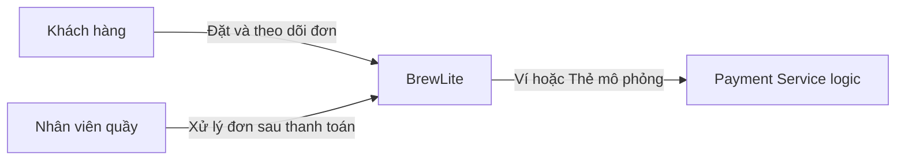
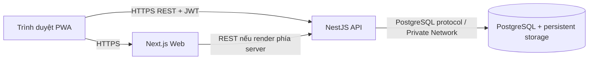

# Kiến trúc hệ thống BrewLite (Task 3.1)

- **Phiên bản:** 1.3 – cập nhật đồng bộ `origin/main@ad3e7a2` ngày 14/11/2026, chờ TV2 review
- **Phương pháp trình bày:** C4 model (Level 1–2) kết hợp kiến trúc phân lớp cho backend. Các quyết định quan trọng được ghi tại `docs/architecture/adr/`.
- **Tài liệu liên quan:** [SRS tổng quát](requirements/srs.md) *(nguồn chuẩn mã FR/NFR đã hợp nhất)*, [Use-case checkout](requirements/use-case-checkout.md), [Điều kiện triển khai (D-20)](architecture/deployment-readiness.md), [Sơ đồ triển khai Render](diagrams/deployment-render.svg) ([nguồn PUML](diagrams/deployment-render.puml)).

> **Lưu ý hiện trạng:** Đây là thiết kế đề xuất, không phải xác nhận hệ thống đã triển khai. Đối chiếu ngày `14/11/2026` trên `origin/main@ad3e7a2` (sau PR #54), `origin/Huy@bdf5891`, `origin/Nghia1@9f6cb4f` (PR #53) và `origin/tai@15cb1f8`: nhánh `main` chưa có ứng dụng thực thi (`apps/api`, `apps/web`, `.github/workflows` mới chỉ có `.gitkeep`); mã API/Prisma/Compose DB hiện nằm riêng trên `origin/tai`; chưa có code Next.js web, Dockerfile, CI/CD workflow hay URL production. PR #53 (chưa merge) đang xung đột với PR #54 vừa merge về bộ mã FR và các file SRS thành phần.

Tài liệu này là đầu mối duy nhất cho mô tả kiến trúc **D-13**. [Đường dẫn kiến trúc cũ](architecture/architecture.md) trỏ về đây để tránh duy trì hai luồng mô tả payment khác nhau. Xung đột ORM (`TypeORM` vs `Prisma`) và đánh số ADR của các mảng khác vẫn chờ chủ sở hữu thống nhất, không được xem là đã giải quyết.

## 1. Mục tiêu và ràng buộc kiến trúc

| Nhóm | Nội dung |
|---|---|
| Mục tiêu | Hỗ trợ luồng: Xem menu → Chọn tùy chọn → Giỏ hàng → Đặt đơn → Thanh toán → Theo dõi đơn |
| Ràng buộc bắt buộc | Next.js (mobile-first/PWA), NestJS, PostgreSQL, Docker |
| Ràng buộc đề tài | Thanh toán mô phỏng; chạy local bằng docker-compose; triển khai production qua CI/CD; database production không public trực tiếp |
| Thuộc tính chất lượng ưu tiên | Tính đúng đắn dữ liệu (đơn hàng/tồn kho/thanh toán), bảo mật, dễ triển khai, dễ kiểm thử |
| Quy mô | Một cửa hàng, tải thấp–trung bình, nhóm 6 người, thời gian 2 Sprint |

## 2. C4 – Level 1: System Context



Payment Service là actor logic; cách triển khai đề xuất là adapter bên trong API (`ADR-006`).

| Thành phần | Mô tả |
|---|---|
| Khách hàng | Đặt và thanh toán đồ uống, theo dõi đơn trên điện thoại |
| Nhân viên quầy | Xem đơn và cập nhật trạng thái đơn (`PAID → PREPARING → READY → COMPLETED`) |
| BrewLite | Hệ thống đặt đồ uống (`apps/web` + `apps/api` + PostgreSQL) |
| Cổng thanh toán (mô phỏng) | Hệ thống bên ngoài về mặt logic, được cài đặt bằng adapter chạy trong API |

## 3. C4 – Level 2: Container



Sơ đồ trên minh họa mức container; cổng, TLS termination, cơ chế migration và hạ tầng Render dự kiến được chi tiết tại [Điều kiện triển khai (D-20)](architecture/deployment-readiness.md) và [Sơ đồ triển khai Render](diagrams/deployment-render.svg).

| Container | Công nghệ | Trách nhiệm | Mã nguồn dự kiến |
|---|---|---|---|
| Web App | Next.js, PWA | Giao diện mobile-first, giỏ hàng phía client, gọi API, hiển thị loading/empty/error | `apps/web` |
| API | NestJS | Nghiệp vụ, xác thực JWT, validate, transaction, idempotency, job nền, gateway thanh toán mô phỏng | `apps/api` |
| Database | PostgreSQL | Lưu người dùng, menu, đơn hàng, thanh toán, idempotency key | `apps/api/prisma/` *(nếu chốt Prisma)* hoặc migrations |

## 4. Kiến trúc backend (Modular Monolith)

Backend tổ chức dạng modular monolith trên NestJS, chia theo miền nghiệp vụ tương ứng 4 phân hệ backend của nhóm:

```text
apps/api/src/
  common/       # config validation, logger, guards, decorators, error filters
  prisma/       # (hoặc database/) kết nối DB dùng chung
  auth/         # TV2: đăng ký, đăng nhập, JWT, Users
  products/     # TV3: danh mục, sản phẩm, size, topping, tồn kho
  orders/       # TV4: tạo đơn (transaction), validate, lịch sử/chi tiết, cập nhật trạng thái
  payments/     # TV4: thanh toán mô phỏng, idempotency, job nền đối soát/hủy đơn
  health/       # TV2: GET /health, GET /health/live
```

Mỗi module theo 3 lớp:

| Lớp | Thành phần | Trách nhiệm |
|---|---|---|
| Presentation | Controller, DTO (`class-validator`), Guards | Nhận HTTP request, validate input, kiểm tra JWT/role, map response/HTTP status |
| Application / Domain | Service | Quy tắc nghiệp vụ: tính giá server, chuyển trạng thái, transaction, idempotency |
| Infrastructure | Repository / `PrismaService`, Payment gateway adapter | Truy cập DB và hệ thống ngoài |

**Quy tắc phụ thuộc:**
- Trong module: `Controller → Service → Repository/PrismaService hoặc Adapter`.
- Giữa các module: chỉ gọi qua service được export, không truy cập bảng của nhau; hướng một chiều `payments → orders → products`, không phụ thuộc vòng. Các method tham gia giao dịch nhận context transaction (`tx`) để nhiều module chạy chung một transaction.
- Mục tiêu kiểm soát tự động: dùng ESLint rule (`no-restricted-imports`) trong CI. Hiện tại `.github/workflows` chưa có workflow và `origin/tai:apps/api/package.json` chưa có script `lint`, nên chưa có bằng chứng kiểm tra tự động.
- Job nền (hủy đơn quá hạn, đối soát payment treo) đặt trong module `payments`, chạy trong tiến trình API bằng `@nestjs/schedule`.

**Thiết kế bảo mật (ADR-007; chưa triển khai đầy đủ):** JWT HS256 sống ngắn, `JwtAuthGuard` toàn cục kèm `@Public()` cho endpoint công khai, `RolesGuard` cho `CUSTOMER`/`STAFF`, kiểm tra quyền sở hữu đơn trong service, mật khẩu băm bằng bcrypt.

## 5. Frontend Next.js / PWA

- **Mobile-first:** layout ưu tiên màn hình nhỏ (từ 320 px, kiểm tra lịch sử ở 360/390 px), vùng chạm chính `>= 48x48` CSS px.
- **PWA:** `manifest.webmanifest`, service worker cache tài nguyên tĩnh và trang menu; **không** cache các API có xác thực (đơn hàng, thanh toán).
- **Gọi API:** lớp `lib/api` tập trung, tự gắn JWT trong header `Authorization`; tự sinh `Idempotency-Key` cho mỗi ý định thanh toán và giữ nguyên key khi retry cùng ý định; đơn mới dùng key mới.
- **Phiên đăng nhập:** khi API trả `401`, chuyển hướng đăng nhập và giữ giỏ hàng (lưu phía client).
- **Trạng thái UI:** mọi màn hình dữ liệu đều tách bạch trạng thái loading / empty / error; trạng thái đơn không chỉ phân biệt bằng màu.
- **Cấu hình:** biến `NEXT_PUBLIC_API_URL` được nhúng lúc build Docker/Next.js cho từng môi trường (ADR-008); không đặt secret trong bất kỳ biến `NEXT_PUBLIC_*` nào.

## 6. PostgreSQL và cơ chế migration

- **Xung đột ORM đang chờ chốt:** Trên `main` tồn tại song song [ADR TypeORM (TV3 – Proposed)](architecture/adr/003-orm-schema-catalog.md) và [ADR Prisma (TV4 – Accepted)](architecture/adr/003-postgresql-prisma.md); nhánh `origin/tai@15cb1f8` đang dùng **Prisma** (`apps/api/prisma/schema.prisma`). Các mô tả Prisma dưới đây phản ánh giải pháp theo mã hiện có trên `origin/tai`, **không thay thế** quyết định chung mà TV3/TV4/TV1 cần chốt.
- **Local:** `prisma migrate dev` tạo migration mới (nếu chốt Prisma). **Production/CI:** `prisma migrate deploy` chỉ áp dụng các migration đã commit (không dùng `migrate dev` hay `db push` ở production).
- **Migration khi deploy:** chạy như một bước kiểm soát riêng **trước khi chuyển lưu lượng** sang bản mới; thất bại thì pipeline dừng. Vì runner CI công khai không được kết nối trực tiếp vào DB private trên Render, cần dùng tác vụ chạy phía Render trong mạng nội bộ.
- **Seed:** script seed phải idempotent (`prisma db seed` hoặc tương đương). Dữ liệu danh mục/món mẫu có thể chạy kiểm soát; tài khoản demo chỉ dành cho local/staging.
- **Migration an toàn:** ưu tiên thay đổi tương thích ngược (expand → contract); rollback dùng migration sửa ngược hoặc khôi phục snapshot trước migration.
- **Ràng buộc dữ liệu bắt buộc:** `CHECK (stock_quantity >= 0)`, giá và phụ thu nguyên VND `>= 0`, partial unique index `payments(order_id) WHERE status = 'SUCCESS'`, khóa duy nhất `(user_id, key)` cho idempotency, khóa ngoại rõ ràng.
- **Storage:** PostgreSQL local dùng persistent volume trong `docker-compose.yml`; production dùng managed persistent storage và **tắt external/public access**.

## 7. Dịch vụ thanh toán mô phỏng

- Interface `PaymentGateway` có `charge(request)` (idempotent theo key) và `getStatus(idempotencyKey)` để đối soát sau timeout (`GatewayTimeoutError`).
- `MockPaymentGateway` (Ví/Thẻ) cho phép mô phỏng thành công, từ chối, timeout và độ trễ; lưu trạng thái giả lập trong DB để không mất khi API khởi động lại.
- Chọn provider qua `PAYMENT_PROVIDER=mock`, cho phép thay bằng cổng thật mà không sửa nghiệp vụ cốt lõi (ADR-006).

## 8. Logging, health check, quản lý cấu hình

| Hạng mục | Giải pháp |
|---|---|
| Logging | Log JSON có cấu trúc (pino/`nestjs-pino`), gắn `requestId`, xuất ra stdout; redact `authorization`, `cookie`, mật khẩu, token; không log số thẻ hoặc secret (`NFR-07`) |
| Health check | `GET /health` (readiness: kiểm tra API + kết nối DB, trả 200 hoặc 503 khi mất DB) theo `NFR-16`; thống nhất với `ADR-008` về `/health/live` trước khi cài đặt `health` module |
| Cấu hình & cổng | Biến môi trường 12-factor, validate khi khởi động; tương thích biến `PORT` do Render cấp cho Web Service (mã `origin/tai:apps/api/src/main.ts` hiện chỉ đọc `API_PORT`, cần bổ sung `PORT ?? API_PORT ?? 4000` khi tích hợp) |
| Secret | Lưu ở CI/Render secret manager; repository chỉ chứa `.env.example` (`NFR-17`) |

## 9. Luồng nghiệp vụ đặt và thanh toán (tổng hợp tham chiếu)

1. `POST /orders` (JWT) → kiểm tra JWT/DTO → transaction: kiểm tra & trừ tồn kho có điều kiện, tạo `Order` (`PENDING_PAYMENT`) và `OrderItem` với giá tính phía server + snapshot; hết hàng thì rollback trả `409`.
2. `POST /payments` (`Idempotency-Key`) → kiểm tra chủ đơn & trạng thái, lưu key `IN_PROGRESS` → gọi gateway mô phỏng:
   - Thành công → `Payment=SUCCESS`, `Order=PAID`.
   - Thất bại → `Payment=FAILED`, `Order=PAYMENT_FAILED`, hoàn kho đúng một lần; thử lại bằng đơn mới.
   - Timeout → giữ trạng thái chờ (`202`), đối soát qua `getStatus` / job nền.
3. Nhân viên (`STAFF`) xem đơn cần xử lý và chuyển trạng thái hợp lệ `PAID → PREPARING → READY → COMPLETED`.

*(Chi tiết hợp đồng nghiệp vụ thuộc TV4/TV2/TV3 tại ADR-004, ADR-005, [use-case-checkout.md](requirements/use-case-checkout.md) và [srs.md](requirements/srs.md)).*

## 10. Lý do chọn kiến trúc và Trade-off

**Lựa chọn:** Monorepo + Modular Monolith (NestJS) + Next.js tách riêng + PostgreSQL.

| Ưu điểm | Hạn chế | Trade-off |
|---|---|---|
| Triển khai/gỡ lỗi đơn giản, phù hợp nhóm 6 người trong 2 Sprint | Không scale độc lập từng module API | Chấp nhận cho tải một cửa hàng; giữ ranh giới module rõ để tách sau nếu cần |
| Transaction ACID trong một DB bảo đảm nhất quán đơn – kho – thanh toán | Một DB là điểm lỗi đơn (SPOF) | Đánh đổi lấy tính toàn vẹn tài chính/kho; bù bằng persistent storage và backup |
| Monorepo tập trung code, docs, sơ đồ và traceability | CI phải lọc hoặc tách job hợp lý để tránh build thừa | Vẫn phải chạy đủ quality gate bắt buộc cho web/API khi merge vào `main` |
| Tách Web/API giúp tận dụng SSR/PWA độc lập với API | Cần cấu hình CORS, 2 URL HTTPS và build-time env cho web | Truyền cấu hình theo môi trường qua biến môi trường/build arg |

## 11. ADR hiện có và các sai khác cần nhóm chốt

| Mã file trên `main` | Quyết định | Sai khác / Hành động cần chốt |
|---|---|---|
| `001-monorepo.md` | Monorepo + Docker (TV1 – D-14) | Chờ TV2 review bản cập nhật mới |
| `002-modular-monolith-nestjs.md` | Backend NestJS modular monolith | Đang trùng dải số với D-15 (phân công ghi `ADR 002: JWT và bảo mật`) |
| `003-orm-schema-catalog.md` vs `003-postgresql-prisma.md` | TypeORM (TV3) vs Prisma (TV4) | **Mâu thuẫn trực tiếp — TV3/TV4/TV1 phải chốt 1 ORM duy nhất** |
| `004-transaction-order-inventory.md` | Transaction đơn hàng & tồn kho | Đủ nội dung nền; chờ khớp enum/sequence |
| `005-idempotency-payment.md` | Idempotency thanh toán | Đang trùng số với D-18 (phân công ghi `ADR 005: Next.js PWA`) |
| `006-mock-payment-gateway.md` | Mock Payment Gateway | Đang trùng số với D-19 (phân công ghi `ADR 006: Chiến lược kiểm thử`) |
| `007-jwt-authentication.md` | JWT Authentication | Nội dung khớp mảng TV2 nhưng khác mã số trong Excel D-15 |
| `008-logging-health-config.md` | Logging, health check, cấu hình | Cần đồng nhất endpoint `/health` và `/health/live` với TV2 |

## 12. Truy vết Sơ đồ triển khai (`D-20`) → Kiến trúc → Mã nguồn

| Thành phần trong deployment diagram | Mục liên quan | Mã nguồn mục tiêu | Nền tảng dự kiến & Hiện trạng `14/11/2026` |
|---|---|---|---|
| Thiết bị người dùng (PWA) | Mục 2, 5 | `apps/web` | Trình duyệt / PWA; `apps/web` trên `main` mới chỉ có `.gitkeep` |
| Web App (Next.js) | Mục 3, 5 | `apps/web`, `apps/web/Dockerfile` | Render Web Service; chưa có app/Dockerfile/URL |
| API (NestJS) | Mục 3, 4, 7, 8 | `apps/api`, `apps/api/Dockerfile` | Render Web Service; code API nằm ở `origin/tai@15cb1f8`, chưa vào `main` |
| PostgreSQL + persistent storage | Mục 3, 6 | `apps/api/prisma/`, `docker-compose.yml` | Render Postgres (private network); trên `tai` mới chỉ compose DB local |
| Container Registry | Mục 6, D-20 | `.github/workflows` | Chưa chốt nhà cung cấp registry (chỉ dùng nếu Render pull prebuilt image) |
| Pipeline CI/CD | ADR-001, D-07 | `.github/workflows` | GitHub Actions; hiện có `0` workflow trên `main` |

## 13. Đối chiếu liên kết với bài làm của nhóm (`14/11/2026`)

| Đầu vào đã đọc | Điểm phù hợp | Chỗ lệch & Ảnh hưởng | Đề xuất cho chủ sở hữu |
|---|---|---|---|
| `origin/main:docs/requirements/srs.md@ad3e7a2` (PR #54) & PR #53 | Đã chốt `NFR-14..20` cho triển khai và `NFR-07` cho logging | Mục 1 `srs.md` còn ghi `NFR-01…NFR-14`, mục 5 ghi nhầm `FR-37…FR-37`, mục 4 giữ link tới 2 file SRS đã xóa; xung đột trực tiếp với PR #53 | TV2 & TV3 hợp nhất/chốt 1 dải mã FR duy nhất và sửa link gãy |
| `origin/Huy@bdf5891` (`activity-diagram.puml/.png/.svg`) | Đã có swimlane, kiểm tra tồn kho và nhánh đăng nhập | Chưa mở PR; nhánh dính gitlink rác `BrewLite_Assignment_2`, sửa file SRS đã bị xóa, Activity lặp vô tận khi thanh toán thất bại và thiếu bước giỏ hàng | TV5 dọn nhánh, chỉnh Activity theo SRS và mở PR để TV6 review |
| `origin/main:docs/diagrams/sequence-checkout.puml/.svg` | Đủ 5 lifeline, JWT, transaction, idempotency | `.puml` lệch `.svg`; nhánh hết hàng không dừng mà vẫn chảy xuống HTTP `201` và thanh toán | TV4 sửa `.puml` và xuất lại `.svg`/`.png` gửi TV1 review |
| `origin/main:docs/diagrams/class-domain.puml` | Đủ thực thể `User`, `Product`, `Order`, `Payment`, snapshot | Thiếu `PAYMENT_FAILED` trong `OrderStatus`, dùng `SUCCEEDED` thay cho `SUCCESS` ở `PaymentStatus` | TV3 đồng bộ enum khớp với SRS và schema trên `origin/tai` |
| `origin/tai@15cb1f8` (`apps/api`, `docker-compose.yml`) | Có Prisma schema (`PAYMENT_FAILED`, `SUCCESS`), transaction và 7 e2e specs | Chưa vào `main`; thiếu script `lint`, thiếu `/health`, `main.ts` chỉ đọc `API_PORT` (chưa fallback `PORT` của Render), chưa có `apps/web` | TV4 & TV3 chốt ADR-003 trước; sau đó TV1 tích hợp Dockerfile, Compose 3 service và CI |
