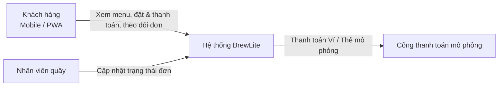
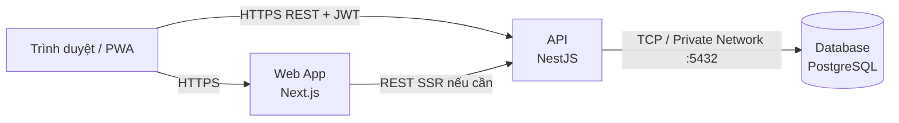

# Kiến trúc hệ thống BrewLite (Task 3.1)

- **Phiên bản:** 1.2 (cập nhật 2026-11-14)
- **Phương pháp trình bày:** C4 model (Level 1–2) kết hợp kiến trúc phân lớp cho backend. Các quyết định quan trọng được ghi tại `docs/architecture/adr/` (ADR-001 đến ADR-008).
- **Tài liệu liên quan:** [SRS](../requirements/srs.md), [Use-case checkout](../requirements/use-case-checkout.md), [Deployment diagram](../diagrams/deployment-render.svg) ([PUML](../diagrams/deployment-render.puml))

## 1. Mục tiêu và ràng buộc kiến trúc

| Nhóm | Nội dung |
|---|---|
| Mục tiêu | Hỗ trợ luồng: Xem menu → Chọn tùy chọn → Giỏ hàng → Đặt đơn → Thanh toán → Theo dõi đơn |
| Ràng buộc bắt buộc | Next.js (mobile-first/PWA), NestJS, PostgreSQL, Docker |
| Ràng buộc đề tài | Thanh toán mô phỏng; chạy local bằng docker-compose; triển khai production qua CI/CD; database production không public trực tiếp |
| Thuộc tính chất lượng ưu tiên | Tính đúng đắn dữ liệu (đơn hàng/tồn kho/thanh toán), bảo mật, dễ triển khai, dễ kiểm thử |
| Quy mô | Một cửa hàng, tải thấp–trung bình, nhóm 6 người, thời gian 2 Sprint |

## 2. C4 – Level 1: System Context



| Thành phần | Mô tả |
|---|---|
| Khách hàng | Đặt và thanh toán đồ uống, theo dõi đơn trên điện thoại |
| Nhân viên quầy | Xem đơn và cập nhật trạng thái đơn |
| BrewLite | Hệ thống đặt đồ uống (web + API + database) |
| Cổng thanh toán (mô phỏng) | Hệ thống bên ngoài về mặt logic, được cài đặt bằng adapter chạy trong API (ADR-006) |

## 3. C4 – Level 2: Container



| Container | Công nghệ | Trách nhiệm | Mã nguồn |
|---|---|---|---|
| Web App | Next.js, PWA | Giao diện mobile-first, giỏ hàng phía client, gọi API, hiển thị loading/empty/error | `apps/web` |
| API | NestJS | Nghiệp vụ, xác thực JWT, validate, transaction, idempotency, job nền, gateway thanh toán mô phỏng | `apps/api` |
| Database | PostgreSQL | Lưu dữ liệu bền vững, ràng buộc toàn vẹn | `docker-compose.yml` (local), `apps/api/prisma/` (schema + migrations) |

Cổng thanh toán mô phỏng **không phải container riêng**: nó là adapter `MockPaymentGateway` trong module `payments` của API (`apps/api/src/payments/gateway`), nên xuất hiện ở mức component (mục 4), không ở mức container (ADR-006).

## 4. Kiến trúc phân lớp của backend (NestJS)

Backend là modular monolith: một ứng dụng triển khai duy nhất, chia module theo domain (ADR-002).

```text
apps/api/src/
├── auth/          # đăng ký, đăng nhập, JWT, guard, thực thể User
├── products/      # menu, size, topping, tồn kho
├── orders/        # tạo đơn, PricingService, trạng thái, lịch sử
├── payments/      # thanh toán, idempotency, gateway mô phỏng, job nền
├── promotions/    # mức Could, cắt được
├── loyalty/       # mức Could, cắt được
├── health/        # GET /health, GET /health/live
├── common/        # filter, interceptor, logger, guard dùng chung
├── config/        # đọc và validate biến môi trường
└── prisma/        # PrismaModule + PrismaService (dùng chung)

apps/api/prisma/
├── schema.prisma  # mô hình dữ liệu
├── migrations/    # lịch sử migration (SQL)
└── seed.ts        # dữ liệu mẫu
```

Giỏ hàng được giữ phía client (Web App), chỉ gửi lên server khi đặt đơn; server không có module `cart`.

Mỗi module theo 3 lớp:

| Lớp | Thành phần NestJS | Quy tắc |
|---|---|---|
| Presentation | Controller, DTO (class-validator), Guard | Chỉ nhận/trả HTTP, validate đầu vào, không chứa nghiệp vụ |
| Application/Domain | Service | Nghiệp vụ, quản lý transaction, gọi sang module khác qua service được export |
| Infrastructure | PrismaService (Prisma Client), Payment gateway adapter | Truy cập DB và hệ thống ngoài |

**Quy tắc phụ thuộc:**
- Trong module: Controller → Service → PrismaService/Adapter.
- Giữa các module: chỉ gọi qua service được export, không truy cập bảng của nhau; hướng một chiều `payments → orders → products`, không phụ thuộc vòng. Các method tham gia giao dịch nhận `tx` (`Prisma.TransactionClient`) để nhiều module chạy chung một transaction.
- Quy tắc được kiểm tra tự động trong bước lint của CI (ESLint `no-restricted-imports` hoặc `dependency-cruiser`).
- Job nền (hủy đơn quá hạn, đối soát payment treo) đặt trong module `payments`, chạy trong container API bằng `@nestjs/schedule`.

**Bảo mật (ADR-007):** JWT HS256 sống ngắn, `JwtAuthGuard` toàn cục kèm `@Public()` cho endpoint công khai, `RolesGuard` cho `CUSTOMER`/`STAFF`, kiểm tra quyền sở hữu đơn trong service, mật khẩu băm bằng bcrypt.

## 5. Frontend Next.js / PWA

- **Mobile-first:** layout ưu tiên màn hình nhỏ, thành phần chạm lớn.
- **PWA:** `manifest.webmanifest`, service worker cache tài nguyên tĩnh và trang menu; không cache các API có xác thực (đơn hàng, thanh toán).
- **Gọi API:** lớp `lib/api` tập trung, tự gắn JWT trong header `Authorization`; tự sinh `Idempotency-Key` cho mỗi ý định thanh toán và giữ nguyên key khi retry; đơn mới thì dùng key mới.
- **Phiên đăng nhập:** khi API trả `401`, chuyển sang trang đăng nhập và giữ giỏ hàng (lưu phía client).
- **Trạng thái UI:** mọi màn hình dữ liệu đều có loading / empty / error.
- **Cấu hình:** `NEXT_PUBLIC_API_URL` được nhúng lúc build, nên image web production được build với URL API của production (ADR-008). Không đặt secret trong biến `NEXT_PUBLIC_*`.

## 6. PostgreSQL và cơ chế migration

- Dùng **Prisma** (Prisma Client + Prisma Migrate). Mô hình dữ liệu khai báo trong `apps/api/prisma/schema.prisma` (ADR-003).
- **Local:** `prisma migrate dev` tạo migration mới. **Production/CI:** `prisma migrate deploy` chỉ áp dụng các migration đã commit (không dùng `migrate dev` hay `db push` ở production); Dockerfile và CI chạy `prisma generate` trước bước build.
- `prisma migrate deploy` chạy như **một bước riêng trong pipeline deploy** (trong mạng nội bộ trước khi chuyển lưu lượng sang bản mới); thất bại thì pipeline dừng. Có backup/snapshot trước khi migrate nếu nền tảng hỗ trợ.
- **Seed** bằng `prisma db seed` (`prisma/seed.ts`), idempotent. Dữ liệu tham chiếu (danh mục, sản phẩm, size, topping) được chạy một lần có kiểm soát trên production để menu không rỗng; dữ liệu demo (tài khoản mẫu) chỉ chạy ở local/staging.
- **Migration an toàn:** chỉ thêm cột/bảng theo kiểu tương thích ngược (expand → contract). Prisma không sinh `down`, nên rollback dùng migration mới "sửa ngược" hoặc restore backup.
- **Ràng buộc ở mức DB:** `CHECK (stock_quantity >= 0)`, giá và phụ thu `>= 0`, partial unique index `payments(order_id) WHERE status = 'SUCCESS'` (thêm bằng SQL thủ công trong file migration), `@@unique([userId, key])` cho `idempotency_keys`, khóa ngoại giữa `orders`/`order_items`/`payments`.
- **Docker:** local chạy service `db` với persistent volume; production dùng managed persistent storage và không public trực tiếp.

## 7. Dịch vụ thanh toán mô phỏng

- Interface `PaymentGateway` có `charge(request)` (idempotent theo key) và `getStatus(idempotencyKey)` để đối soát sau timeout; timeout biểu diễn bằng `GatewayTimeoutError`.
- `MockPaymentGateway` (Ví/Thẻ) có hành vi điều khiển bằng số thẻ/ví thử nghiệm: thành công, từ chối, timeout đã trừ tiền, timeout chưa trừ tiền, độ trễ. Trạng thái giao dịch lưu trong bảng riêng `mock_gateway_transactions` để không mất khi API khởi động lại.
- Chọn provider bằng `PAYMENT_PROVIDER=mock`. Có thể thay bằng cổng thật (VNPay/Stripe…) mà không đổi nghiệp vụ nhờ interface.
- Xem ADR-006.

## 8. Logging, health check, quản lý cấu hình

| Hạng mục | Giải pháp |
|---|---|
| Logging | Log JSON có cấu trúc (pino/nestjs-pino), mỗi request có `requestId`, ghi ra stdout; `redact` cho `authorization`, `cookie`, mật khẩu, token; không log số thẻ |
| Health check | `GET /health` (readiness: API + kết nối DB, trả 200/503) và `GET /health/live` (liveness, không kiểm tra DB) bằng `@nestjs/terminus`; `/health/live` dùng cho Docker `HEALTHCHECK`, `/health` dùng cho smoke test sau deploy |
| Cấu hình & cổng | Biến môi trường theo 12-factor; `@nestjs/config` + schema validation, thiếu biến bắt buộc thì app không khởi động; web và API lắng nghe `0.0.0.0:$PORT` trên Render (API fallback `PORT ?? API_PORT ?? 4000`); danh sách biến ở ADR-008 và `.env.example` |
| Secret | Lưu trong secret của CI/nền tảng triển khai; repo chỉ có `.env.example` |

## 9. Luồng nghiệp vụ quan trọng: đặt và thanh toán

1. Client gọi `POST /orders` (JWT) → API validate, mở transaction: trừ tồn kho có điều kiện (`UPDATE ... WHERE stock_quantity >= qty`, theo `product_id` tăng dần), tạo `Order` (`PENDING_PAYMENT`) và `OrderItem`, commit. Hết hàng thì rollback, trả `409 OUT_OF_STOCK`.
2. Client gọi `POST /payments` với header `Idempotency-Key`. API kiểm tra quyền sở hữu và trạng thái đơn, rồi chèn bản ghi key `IN_PROGRESS` (UNIQUE theo `user_id`, `key`). Key đã tồn tại thì: nội dung khác → `422`, đã `COMPLETED` → trả lại kết quả cũ, đang `IN_PROGRESS` → `409`.
3. API gọi Payment Gateway (ngoài transaction DB):
   - **Thành công:** `Payment=SUCCESS`, `Order=PAID`.
   - **Thất bại:** `Payment=FAILED`, `Order=PAYMENT_FAILED` (trạng thái cuối), hoàn tồn kho trong cùng transaction. Muốn thử lại, khách tạo **đơn mới** từ giỏ hàng.
   - **Timeout:** payment giữ `PENDING`, đơn giữ `PENDING_PAYMENT`, API trả `202`; hệ thống đối soát bằng `getStatus` rồi xử lý như hai nhánh trên.
4. Cập nhật đơn và hoàn kho dùng cập nhật có điều kiện (`WHERE status = 'PENDING_PAYMENT'`, hoàn kho chỉ khi cập nhật ảnh hưởng đúng 1 dòng) để không hoàn kho hai lần. Job nền hủy đơn `PENDING_PAYMENT` quá hạn theo cùng quy tắc, chỉ hủy đơn không có payment `PENDING`/`SUCCESS` hoặc sau khi đối soát.
5. Client theo dõi trạng thái qua `GET /orders/:id`.

Chi tiết: ADR-004, ADR-005 và sequence diagram [sequence-checkout.puml](../diagrams/sequence-checkout.puml).

## 10. Lý do chọn kiến trúc, ưu điểm, hạn chế, trade-off

**Lựa chọn:** Monorepo + modular monolith (NestJS) + Next.js tách riêng + PostgreSQL.

| Ưu điểm | Hạn chế | Trade-off |
|---|---|---|
| Đơn giản triển khai và gỡ lỗi; phù hợp quy mô nhóm và thời gian | Không scale từng module độc lập | Chấp nhận vì tải thấp; ranh giới module rõ nên có thể tách thành service sau này |
| Transaction ACID trong một DB đảm bảo nhất quán đơn hàng/tồn kho/thanh toán | Một DB là điểm lỗi duy nhất | Đánh đổi lấy tính đúng đắn; bổ sung backup/persistent volume |
| Monorepo giúp CI/CD, tài liệu và truy vết tập trung | Pipeline phải lọc theo thư mục để tránh build thừa | Lọc theo đường dẫn ở mức job trong một workflow để kiểm tra bắt buộc không bị treo (ADR-001) |
| Tách web/API cho phép deploy và scale độc lập, tận dụng SSR/PWA | Cần cấu hình CORS, quản lý 2 URL; image web phải build theo môi trường | Dùng biến môi trường, build arg trong pipeline và HTTPS |
| Cổng thanh toán qua interface dễ thay thế | Mô phỏng chưa phản ánh đầy đủ webhook/3-D Secure | Mô phỏng thêm timeout/lỗi và `getStatus` để kiểm thử idempotency và đối soát |
| Kiến trúc phân lớp dễ viết unit test | Nhiều lớp hơn cho tính năng nhỏ; truyền `tx` làm chữ ký method dài hơn | Giữ lớp mỏng, tránh trừu tượng thừa |
| Cập nhật có điều kiện và idempotency bảo vệ tính đúng đắn khi đồng thời | Job đối soát làm hệ thống phức tạp hơn | Giới hạn ở đối soát từng giao dịch, không làm đối soát hàng loạt |

## 11. Danh sách ADR

| Mã | Quyết định |
|---|---|
| 001 | Dùng monorepo và đóng gói Docker (`001-monorepo.md`) |
| 002 | Backend NestJS dạng modular monolith |
| 003 | PostgreSQL + Prisma (`003-postgresql-prisma.md`) |
| 004 | Transaction khi tạo đơn và trừ tồn kho |
| 005 | Idempotency cho thanh toán |
| 006 | Dịch vụ thanh toán mô phỏng qua interface |
| 007 | Xác thực bằng JWT |
| 008 | Logging, health check, cấu hình |

## 12. Truy vết deployment diagram → kiến trúc → mã nguồn

Mỗi container/dịch vụ trong [deployment-render.svg](../diagrams/deployment-render.svg) ([PUML](../diagrams/deployment-render.puml)) truy vết về một thành phần trong tài liệu này và mã nguồn trên nền tảng **Render**.

| Thành phần trong deployment diagram | Mục trong tài liệu này | Mã nguồn | Nền tảng thực tế |
|---|---|---|---|
| Thiết bị người dùng (trình duyệt/PWA) | Mục 2, 5 | `apps/web` | Trình duyệt / Mobile PWA |
| Web App (Next.js) | Mục 3, 5 | `apps/web`, `apps/web/Dockerfile` | Render Web Service (Docker, `$PORT`) |
| API (NestJS) | Mục 3, 4, 7, 8 | `apps/api`, `apps/api/Dockerfile` | Render Web Service (Docker, `$PORT`) |
| PostgreSQL + persistent storage | Mục 3, 6 | `apps/api/prisma/`, `docker-compose.yml` | Render PostgreSQL (Private Network, Persistent Storage) |
| Container registry | Mục 8 (pipeline) | `.github/workflows` | GitHub Container Registry (GHCR) |
| Pipeline CI/CD | ADR-001, ADR-008 | `.github/workflows` | GitHub Actions |
