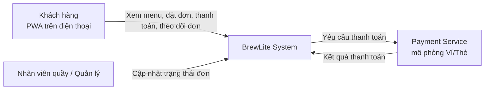
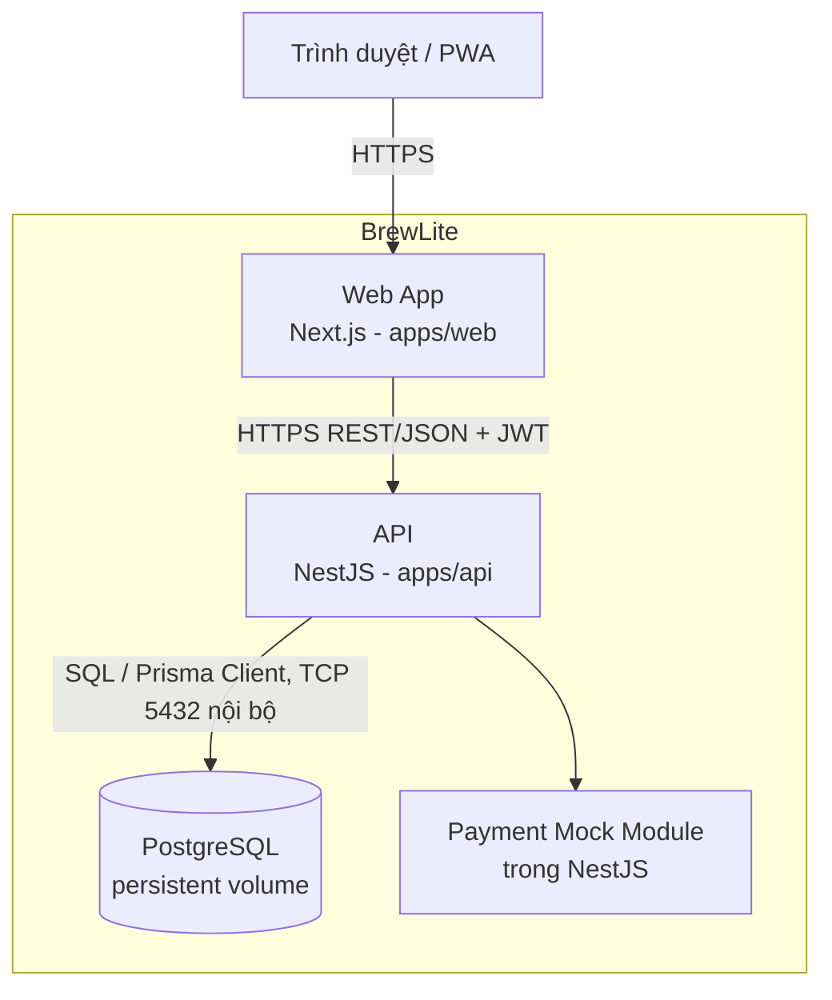

# Kiến trúc hệ thống BrewLite (Task 3.1)

> Phiên bản 1.0 – Phương pháp trình bày: **C4 model (Level 1–2) kết hợp kiến trúc phân lớp** cho backend.
> Các quyết định quan trọng được ghi tại [`docs/architecture/adr/`](./adr).

## 1. Mục tiêu và ràng buộc kiến trúc

| Nhóm                          | Nội dung                                                                                 |
| ----------------------------- | ---------------------------------------------------------------------------------------- |
| Mục tiêu                      | Hỗ trợ luồng: Xem menu → Chọn tùy chọn → Giỏ hàng → Đặt đơn → Thanh toán → Theo dõi đơn  |
| Ràng buộc bắt buộc            | Next.js (mobile-first/PWA), NestJS, PostgreSQL, Docker                                   |
| Ràng buộc đề tài              | Thanh toán mô phỏng; chạy local bằng `docker-compose`; triển khai production qua CI/CD   |
| Thuộc tính chất lượng ưu tiên | Tính đúng đắn dữ liệu (đơn hàng/tồn kho/thanh toán), bảo mật, dễ triển khai, dễ kiểm thử |
| Quy mô                        | Một cửa hàng, tải thấp–trung bình, nhóm 4–5 người, thời gian 2 Sprint                    |

## 2. C4 – Level 1: System Context



## 3. C4 – Level 2: Container



| Container    | Công nghệ                  | Trách nhiệm                                                                         | Mã nguồn                                                       |
| ------------ | -------------------------- | ----------------------------------------------------------------------------------- | -------------------------------------------------------------- |
| Web App      | Next.js, PWA               | Giao diện mobile-first, giỏ hàng phía client, gọi API, hiển thị loading/empty/error | `apps/web`                                                     |
| API          | NestJS                     | Nghiệp vụ, xác thực JWT, validate, transaction, idempotency                         | `apps/api`                                                     |
| Database     | PostgreSQL                 | Lưu dữ liệu bền vững, ràng buộc toàn vẹn                                            | `docker-compose.yml`, `apps/api/prisma/` (schema + migrations) |
| Payment Mock | Module NestJS (`payments`) | Giả lập cổng thanh toán Ví/Thẻ, có thể cấu hình thành công/thất bại/timeout         | `apps/api/src/payments/gateway`                                |

## 4. Kiến trúc phân lớp của backend (NestJS)

Backend là **modular monolith**: một ứng dụng triển khai duy nhất, chia module theo domain.

```
apps/api/src/
├── auth/          # đăng ký, đăng nhập, JWT, guard
├── users/
├── products/      # menu, size, topping
├── cart/          # (nếu lưu giỏ ở server)
├── orders/        # tạo đơn, trạng thái, lịch sử
├── payments/      # thanh toán, gateway mô phỏng, idempotency
├── promotions/
├── loyalty/
├── health/        # GET /health
├── common/        # filter, interceptor, logger, idempotency
├── config/        # đọc & validate biến môi trường
└── prisma/        # PrismaModule + PrismaService (dùng chung)

apps/api/prisma/
├── schema.prisma  # mô hình dữ liệu
├── migrations/    # lịch sử migration (SQL)
└── seed.ts        # dữ liệu mẫu
```

Mỗi module theo 3 lớp:

| Lớp                | Thành phần NestJS                                      | Quy tắc                                                                 |
| ------------------ | ------------------------------------------------------ | ----------------------------------------------------------------------- |
| Presentation       | Controller, DTO (class-validator), Guard               | Chỉ nhận/trả HTTP, validate đầu vào, không chứa nghiệp vụ               |
| Application/Domain | Service                                                | Nghiệp vụ, quản lý transaction, gọi sang module khác qua service export |
| Infrastructure     | PrismaService (Prisma Client), Payment gateway adapter | Truy cập DB và hệ thống ngoài                                           |

Quy tắc phụ thuộc: Controller → Service → PrismaService/Adapter; module khác chỉ gọi qua service được `export`, không truy cập trực tiếp bảng của nhau.

## 5. Frontend Next.js / PWA

- **Mobile-first**: layout ưu tiên màn hình nhỏ, thành phần chạm lớn.
- **PWA**: `manifest.webmanifest`, service worker cache tài nguyên tĩnh và trang menu; không cache các API có xác thực (đơn hàng, thanh toán).
- **Gọi API**: lớp `lib/api` tập trung, tự gắn JWT, tự sinh `Idempotency-Key` cho thao tác thanh toán và giữ nguyên key khi retry.
- **Trạng thái UI**: mọi màn hình dữ liệu đều có loading / empty / error.
- **Cấu hình**: `NEXT_PUBLIC_API_URL` qua biến môi trường.

## 6. PostgreSQL và cơ chế migration

- Dùng **Prisma** (Prisma Client + Prisma Migrate). Mô hình dữ liệu khai báo trong `apps/api/prisma/schema.prisma`.
- Local: `prisma migrate dev` tạo migration mới; production/CI: **`prisma migrate deploy`** chỉ áp dụng các migration đã commit (không dùng `migrate dev` hay `db push` ở production).
- Bước `prisma migrate deploy` được gọi trong pipeline deploy trước khi chuyển lưu lượng sang bản mới.
- Seed dữ liệu mẫu (sản phẩm, topping) bằng `prisma db seed` (`prisma/seed.ts`), chỉ chạy ở local/staging.
- Nguyên tắc migration an toàn: chỉ thêm cột/bảng theo kiểu tương thích ngược (expand → contract); Prisma không sinh `down`, nên rollback dùng migration mới "sửa ngược" hoặc restore backup.
- Ràng buộc quan trọng ở mức DB: `CHECK (stock >= 0)` và partial unique index cho thanh toán thành công (Prisma chưa khai báo được trực tiếp nên thêm bằng SQL thủ công trong file migration), `@@unique([userId, key])` cho idempotency, khóa ngoại giữa `orders`/`order_items`/`payments`.

## 7. Dịch vụ thanh toán mô phỏng

- Định nghĩa interface `PaymentGateway { charge(request): Promise<ChargeResult> }`.
- Hiện thực `MockPaymentGateway` (Ví/Thẻ) với hành vi điều khiển bằng biến môi trường hoặc số thẻ test: thành công, từ chối, timeout.
- Có thể thay bằng cổng thật (VNPay/Stripe…) mà không đổi nghiệp vụ nhờ interface.
- Xem [ADR-006](./adr/006-mock-payment-gateway.md).

## 8. Logging, health check, quản lý cấu hình

| Hạng mục     | Giải pháp                                                                                                                                 |
| ------------ | ----------------------------------------------------------------------------------------------------------------------------------------- |
| Logging      | Log JSON có cấu trúc (pino/nestjs-pino), mỗi request có `requestId`; **không log** mật khẩu, JWT, số thẻ                                  |
| Health check | `GET /health` (liveness) và kiểm tra kết nối DB (readiness) bằng `@nestjs/terminus`; dùng cho Docker healthcheck và smoke test sau deploy |
| Cấu hình     | Biến môi trường theo 12-factor; `@nestjs/config` + schema validation, thiếu biến bắt buộc thì app không khởi động                         |
| Secret       | Lưu trong secret của CI/nền tảng triển khai; repo chỉ có `.env.example`                                                                   |

## 9. Luồng nghiệp vụ quan trọng: đặt và thanh toán

1. Client gọi `POST /orders` (JWT) → API validate, mở transaction: khóa/ trừ tồn kho có điều kiện, tạo `Order` (`PENDING_PAYMENT`) và `OrderItem`, commit.
2. Client gọi `POST /payments` với header `Idempotency-Key` → API kiểm tra key; nếu đã xử lý thì trả lại kết quả cũ.
3. API gọi Payment Gateway; thành công → `Payment=SUCCESS`, `Order=PAID`; thất bại → `Payment=FAILED`, đơn vẫn `PENDING_PAYMENT` để thử lại, quá hạn thì hủy và hoàn tồn kho.
4. Client theo dõi trạng thái qua `GET /orders/:id`.

Chi tiết: [ADR-004](./adr/004-transaction-order-inventory.md), [ADR-005](./adr/005-idempotency-payment.md) và sequence diagram `docs/diagrams/sequence-checkout`.

## 10. Lý do chọn kiến trúc, ưu điểm, hạn chế, trade-off

**Lựa chọn:** Monorepo + modular monolith (NestJS) + Next.js tách riêng + PostgreSQL.

| Ưu điểm                                                                     | Hạn chế                                                    | Trade-off                                                                        |
| --------------------------------------------------------------------------- | ---------------------------------------------------------- | -------------------------------------------------------------------------------- |
| Đơn giản triển khai và gỡ lỗi; phù hợp quy mô nhóm và thời gian             | Không scale từng module độc lập                            | Chấp nhận vì tải thấp; ranh giới module rõ nên có thể tách thành service sau này |
| Transaction ACID trong một DB đảm bảo nhất quán đơn hàng/tồn kho/thanh toán | Một DB là điểm lỗi duy nhất                                | Đánh đổi lấy tính đúng đắn; bổ sung backup/persistent volume                     |
| Monorepo giúp CI/CD, tài liệu và truy vết tập trung                         | Pipeline phải lọc theo thư mục để tránh build thừa         | Dùng path filter trong GitHub Actions                                            |
| Tách web/API cho phép deploy và scale độc lập, tận dụng SSR/PWA             | Cần cấu hình CORS và quản lý 2 URL                         | Dùng biến môi trường và HTTPS                                                    |
| Cổng thanh toán qua interface dễ thay thế                                   | Mô phỏng chưa phản ánh đầy đủ webhook/độ trễ của cổng thật | Mô phỏng thêm timeout/lỗi để kiểm thử idempotency                                |
| Kiến trúc phân lớp dễ viết unit test                                        | Nhiều lớp hơn cho tính năng nhỏ                            | Giữ lớp mỏng, tránh trừu tượng thừa                                              |

## 11. Danh sách ADR

| Mã                                              | Quyết định                                |
| ----------------------------------------------- | ----------------------------------------- |
| [001](./adr/001-monorepo.md)                    | Dùng monorepo                             |
| [002](./adr/002-modular-monolith-nestjs.md)     | Backend NestJS dạng modular monolith      |
| [003](./adr/003-postgresql-prisma.md)           | PostgreSQL + Prisma (Prisma Migrate)      |
| [004](./adr/004-transaction-order-inventory.md) | Transaction khi tạo đơn và trừ tồn kho    |
| [005](./adr/005-idempotency-payment.md)         | Idempotency cho thanh toán                |
| [006](./adr/006-mock-payment-gateway.md)        | Dịch vụ thanh toán mô phỏng qua interface |
| [007](./adr/007-jwt-authentication.md)          | Xác thực bằng JWT                         |
| [008](./adr/008-logging-health-config.md)       | Logging, health check, cấu hình           |
