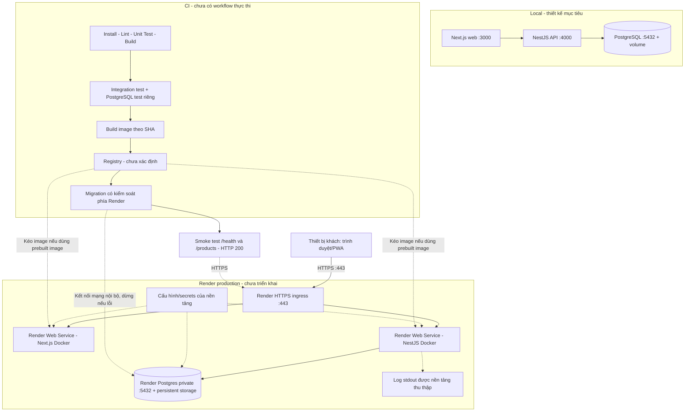

# D-20 – Điều kiện hoàn thiện và triển khai trên Render

**Bản nháp TV1 ngày 14/11/2026 (cập nhật theo `origin/main@ad3e7a2`) — chờ TV2 review, chưa deploy.** Công việc `I-08b / D-20` (GitHub `#42`); reviewer `TV2`. Căn cứ đề `Assignment2-BrewLite.pdf` mục 5.2 và nhóm yêu cầu triển khai đã hợp nhất trong [SRS tổng quát](../requirements/srs.md) (`NFR-14..20`).

TV1 đã chọn **Render** làm nền tảng mục tiêu để lập thiết kế triển khai ở bước `D-20`. Đây là lựa chọn thiết kế ban đầu, **không phải** xác nhận đã tạo dịch vụ thật hay URL production hoạt động. Mô hình mục tiêu gồm: hai Render Web Services (Docker cho Next.js web và NestJS API) cùng Render Postgres nằm trong private network. Vùng triển khai (region), gói dịch vụ, service ID, container registry (nếu kéo prebuilt image) và domain thật vẫn chưa khởi tạo và chưa xác minh.

- **Nguồn UML:** [deployment-render.puml](../diagrams/deployment-render.puml)
- **Bản xuất ảnh/vector:** [deployment-render.svg](../diagrams/deployment-render.svg) · [deployment-render.png](../diagrams/deployment-render.png)

Cổng `3000` / `4000` / `5432` là cấu hình local dự kiến từ `.env.example` và `origin/tai:docker-compose.yml`. Trên Render, dịch vụ HTTP phải lắng nghe `0.0.0.0:$PORT` (biến `PORT` do nền tảng cấp); mã trên `origin/tai:apps/api/src/main.ts` hiện chỉ đọc `API_PORT`, cần TV4/TV1 bổ sung fallback `process.env.PORT ?? process.env.API_PORT ?? 4000` trước khi triển khai.

| Thành phần bắt buộc | Đầu mối kiến trúc / mã | Bằng chứng hiện có (`14/11/2026`) | Điều kiện cần trước nghiệm thu |
|---|---|---|---|
| Thiết bị PWA & Next.js Web | [Kiến trúc](../architecture.md), `apps/web` | `origin/main@ad3e7a2` mới chỉ có `.gitkeep` | Source `apps/web`, `Dockerfile`, build-time `NEXT_PUBLIC_API_URL`, URL HTTPS |
| NestJS API container | `apps/api` | Mã API nằm trên `origin/tai@15cb1f8`, chưa vào `main` | `Dockerfile`, đọc `$PORT`, validate env, private networking, URL API |
| PostgreSQL persistent | `apps/api/prisma/`, `docker-compose.yml` | Schema/migration Prisma và Compose riêng service `db` ở `tai` | TV3 đánh dấu `Superseded` cho `003-orm-schema-catalog.md`; bật persistent storage, tắt external access |
| Registry & CI/CD | `.github/workflows` | `main` mới chỉ có `.gitkeep`; `0` workflow runs | Workflow CI/CD, quyết định registry, image tag theo SHA, log chạy thật |
| Cấu hình & secrets | `.env.example`, Render env vars | Có `.env.example` mẫu | Biến môi trường đầy đủ, không đưa secret thật vào Git hoặc log |
| Health & Logging | `I-33` (TV2) & [SRS tổng quát](../requirements/srs.md) | Có thiết kế `GET /health` ở `NFR-16`, logging `NFR-07` và `ADR-008` | Endpoint trả `200`/`503`, log JSON có redact, chốt thống nhất `/health/live` |
| Migration, smoke, rollback | `I-31` (TV1), `I-34` (TV2) | Chưa có pipeline thực thi | Migration trên mạng private, dừng khi lỗi, smoke `/health` & `/products`, kịch bản rollback |

## Trạng thái khả thi và ranh giới triển khai

- **D-13 / D-14 (`I-08a`): LÀM CÓ ĐIỀU KIỆN.** Đã dọn mâu thuẫn hai bản kiến trúc và đồng bộ hiện trạng `main@ad3e7a2`, chờ TV2 review.
- **D-20 (`I-08b`): LÀM CÓ ĐIỀU KIỆN cho bản thiết kế; BỊ CHẶN THỰC CHẤT khi nghiệm thu thật.** Đã chọn Render và xuất đủ `.puml` / `.svg` / `.png` gắn nhãn `DRAFT - NOT DEPLOYED`; không tự đánh dấu Done khi chưa có dịch vụ/URL thật.
- **I-14 / I-15 / I-28 (Sprint 1 & đầu Sprint 2 DevOps): ĐÃ MỞ NÚT ORM (`Prisma`), CÒN CHỜ HỢP NHẤT CODE NỀN.** Đã chốt dùng Prisma; vẫn chưa tạo `Dockerfile`/`ci.yml`/`docker-compose.yml` chính thức trên `main` vì `apps/web` chưa có và `origin/tai:apps/api` chưa hợp nhất vào `main` (còn thiếu script `lint`, fallback `PORT`).
- **I-29 / I-30 / I-31 (Production & CD): BỊ CHẶN THỰC CHẤT.** Chưa tạo tài khoản, dịch vụ, database, secret hay deploy trong lượt này.

## Ràng buộc kỹ thuật Render đã đối chiếu tài liệu chính thức

- Web Next.js (SSR) và NestJS API triển khai dạng Web Service, bind `0.0.0.0` và đọc biến môi trường `PORT`. ([Render Web Services](https://render.com/docs/web-services), [Next.js on Render](https://render.com/docs/deploy-nextjs-app))
- API và Render Postgres đặt cùng region để dùng internal database URL qua mạng nội bộ (`5432`) và **tắt external access** trong cài đặt DB. ([Render Postgres](https://render.com/docs/postgresql-creating-connecting))
- Health check path trỏ `GET /health` kiểm tra kết nối DB (`200`/`503`); smoke test sau deploy gọi cả `/health` và `/products`. ([Render Health Checks](https://render.com/docs/health-checks))
- Nếu kéo prebuilt Docker image từ registry, ghim image theo commit SHA/digest; không dùng thẻ mutable như `latest`. ([Prebuilt Docker Images](https://render.com/docs/deploying-an-image))
- Tác vụ migration (`prisma migrate deploy`) phải chạy trong ngữ cảnh được cấp quyền truy cập mạng nội bộ Render trước khi chuyển lưu lượng; không mở DB công khai ra Internet để public CI runner chọc vào.
