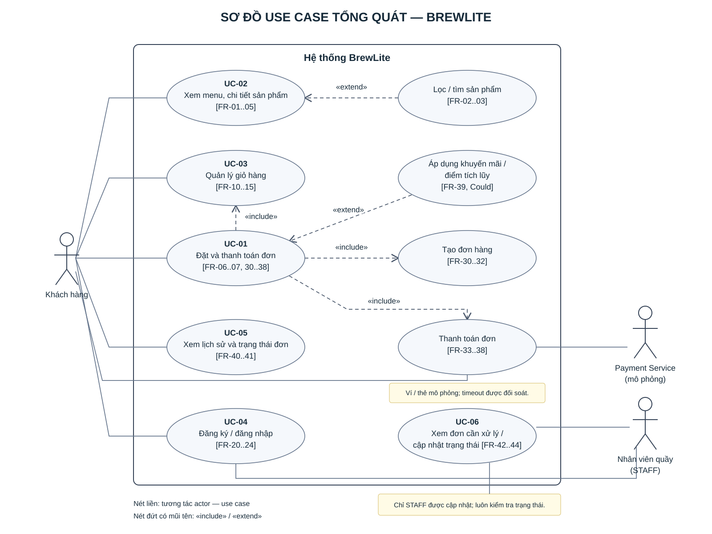

# SRS tổng quát – BrewLite

| Mục | Nội dung |
|---|---|
| Phiên bản | 1.1 – bổ sung SRS giỏ hàng/UI và lịch sử/trạng thái đơn |
| Trạng thái | Bộ mã FR/NFR chính thức dùng chung trong repository |
| Phạm vi | MVP đặt đồ uống tại quầy; thanh toán mô phỏng; một cửa hàng |
| Nguồn | [`context-and-scope.md`](./context-and-scope.md), [`srs-menu-product.md`](./srs-menu-product.md), [`srs-giohang-giaodien.md`](./srs-giohang-giaodien.md), [`srs-order-payment.md`](./srs-order-payment.md), [`srs-order-history-status.md`](./srs-order-history-status.md), [`deployment-nfr.md`](./deployment-nfr.md), [`architecture.md`](../architecture/architecture.md), README |

> **Căn cứ triển khai:** tại thời điểm hợp nhất, `apps/api`, `apps/web` và `tests` chỉ chứa `.gitkeep`; README cũng ghi rõ ứng dụng chưa được triển khai. Vì vậy, SRS này chuẩn hóa yêu cầu từ tài liệu và kiến trúc đã duyệt, không khẳng định tính năng đã có trong mã chạy được.

## 1. Quy ước mã

- Mã `FR-01`…`FR-49` và `NFR-01`…`NFR-20` là mã chuẩn, duy nhất cho toàn dự án.
- Các dải FR giữ nguyên quy ước phân nhóm: `01–09` menu/sản phẩm; `10–19` giỏ hàng; `20–29` xác thực; `30–39` đặt hàng/thanh toán; `40–49` lịch sử/trạng thái đơn. Mã chưa dùng được để trống, không tái sử dụng cho yêu cầu khác.
- NFR được đánh số lại liên tục để loại bỏ các mã cục bộ trùng hoặc không đồng nhất. Bảng ánh xạ NFR cũ ở mục 4 phục vụ truy vết; chỉ mã NFR chuẩn được dùng khi tạo yêu cầu mới.
- FR-09 là mã Won't được giữ duy nhất để lưu quyết định loại bỏ quản trị catalog; Won't và nội dung ngoài phạm vi khác không được cấp mã FR/NFR.

## 2. Stakeholder và quy tắc nghiệp vụ

| Actor | Mục tiêu / quyền chính |
|---|---|
| Khách hàng | Xem menu, chọn món, đăng ký/đăng nhập, đặt và thanh toán đơn, xem lịch sử và trạng thái đơn của mình |
| Nhân viên quầy (STAFF) | Xem đơn và cập nhật trạng thái xử lý đơn |
| Payment Service mô phỏng | Actor phụ nhận yêu cầu thanh toán Ví/Thẻ và trả kết quả; adapter được cài trong API |

Hệ thống phục vụ một cửa hàng, khách nhận tại quầy, đơn vị tiền tệ là VND nguyên, khách phải đăng nhập để đặt đơn, giá hợp lệ do server tính, còn giỏ hàng được giữ ở client. Thanh toán là mô phỏng. Promotion/tích điểm là phạm vi mở rộng (Could); gateway thật, giao hàng, quản trị catalog, hoàn tiền, hủy đơn đã thanh toán và push/SMS/email nằm ngoài phạm vi.

## 3. Yêu cầu chức năng

MoSCoW: **Must** bắt buộc, **Should** nên có, **Could** tùy thời gian.

### 3.1 Menu và sản phẩm (`FR-01`–`FR-09`)

| Mã | Yêu cầu | Ưu tiên |
|---|---|---|
| FR-01 | Hệ thống hiển thị menu phân trang gồm sản phẩm đang bán, tên, ảnh, giá cơ bản, danh mục và tình trạng còn/hết hàng. | Must |
| FR-02 | Khách hàng có thể lọc menu theo danh mục. | Should |
| FR-03 | Khách hàng có thể tìm sản phẩm theo tên, không phân biệt hoa thường và dấu tiếng Việt. | Could |
| FR-04 | Hệ thống hiển thị chi tiết sản phẩm gồm mô tả, ảnh, giá cơ bản, tồn kho và danh mục. | Must |
| FR-05 | Hệ thống hiển thị các size và topping khả dụng của sản phẩm cùng giá phụ thu. | Must |
| FR-06 | Hệ thống tính giá món ở server theo `(giá cơ bản + phụ thu size + tổng phụ thu topping) × số lượng`; không tin giá client gửi. | Must |
| FR-07 | Hệ thống kiểm tra tồn kho và không chấp nhận số lượng vượt tồn kho; mặt hàng hết được biểu thị rõ. | Must |
| FR-08 | Migration/seed tạo dữ liệu menu mẫu và chạy lặp lại không sinh bản ghi trùng. | Must |
| FR-09 | Quản lý thêm/sửa/xóa sản phẩm qua UI/API quản trị. **Won't trong MVP; giữ mã để truy vết quyết định phạm vi.** | Won't |

### 3.2 Giỏ hàng (`FR-10`–`FR-19`)

| Mã | Yêu cầu | Ưu tiên |
|---|---|---|
| FR-10 | Khách thêm món cùng các thuộc tính cấu hình được (size, đường/đá nếu áp dụng, topping) và số lượng vào giỏ; dòng hàng có cùng sản phẩm và toàn bộ tùy chọn giống nhau được gộp số lượng. | Must |
| FR-11 | Khách xem các món trong giỏ gồm ảnh, tên, tùy chọn, đơn giá, số lượng, thành tiền tạm tính và tổng giỏ; giỏ trống có thông báo riêng. | Must |
| FR-12 | Khách tăng/giảm hoặc nhập số lượng; thay đổi cập nhật tổng tạm tính, chặn số lượng âm/vượt tồn; giảm về 0 yêu cầu xác nhận xóa. | Must |
| FR-13 | Khách xóa một dòng hoặc làm trống giỏ; thao tác xóa có xác nhận và giao diện cập nhật đúng trạng thái rỗng. | Must |
| FR-14 | Giỏ được lưu phía client và giữ lại sau khi đóng/mở trình duyệt, kể cả khi khách cần đăng nhập trước khi đặt hàng. | Should |
| FR-15 | Khách nhập mã khuyến mãi tại giỏ; hệ thống kiểm tra mã hợp lệ và hiển thị mức giảm/tổng tạm tính mới. Việc xác thực và tính tiền cuối cùng do server thực hiện theo FR-39. | Could |
| FR-16 | Giao diện mobile-first, responsive từ viewport 320 px trở lên, thích ứng tablet và desktop; vùng chạm chính tối thiểu 48×48 px. | Must |
| FR-17 | Ứng dụng hỗ trợ cài đặt PWA bằng manifest/service worker và cache ngoại tuyến cơ bản cho trang/tài nguyên tĩnh. | Should |
| FR-18 | Khi tải dữ liệu, không hiện màn hình trắng; UI có loading, empty và error state thân thiện, kèm hành động tiếp theo như thử lại. | Must |
| FR-19 | Cung cấp bottom navigation trên mobile, header navigation trên desktop; chuyển trang phía client không làm mất trạng thái ứng dụng không liên quan. | Must |

Giỏ hàng chỉ lưu phía client (ví dụ LocalStorage), theo kiến trúc hiện tại không có cart API/database và không đồng bộ nhiều thiết bị. Yêu cầu FR-CRT-05 về database sync trong tài liệu thành phần được loại khỏi MVP theo lựa chọn client-only; muốn đưa lại phải cập nhật kiến trúc và phạm vi.

**Tiêu chí chấp nhận FR-10–FR-19**

- **AC-10.1:** Nút thêm chỉ hoạt động khi đã chọn các thuộc tính bắt buộc; thêm thành công cập nhật số lượng trên biểu tượng giỏ ngay lập tức; cùng món/cùng toàn bộ tùy chọn được gộp.
- **AC-11.1:** Giỏ hiển thị đúng ảnh, tên, tùy chọn, đơn giá, số lượng, thành tiền và tổng; tổng tạm tính bằng tổng `(đơn giá món + phụ thu topping) × số lượng`; giỏ trống có thông báo riêng.
- **AC-12.1:** Tăng/giảm/nhập số lượng cập nhật tổng; chặn số lượng âm hoặc vượt tồn; giảm về 0 yêu cầu xác nhận xóa.
- **AC-13.1:** Xóa từng món hoặc làm trống giỏ có bước xác nhận; xóa hết đưa UI về trạng thái trống.
- **AC-14.1:** Khách vãng lai và khách đăng nhập đều giữ được giỏ LocalStorage sau khi đóng rồi mở lại trình duyệt; không cam kết khôi phục/sync giỏ trên thiết bị khác.
- **AC-15.1:** Nhập mã khuyến mãi hợp lệ hiển thị số tiền giảm và tổng mới; mã không hợp lệ bị báo rõ; server vẫn xác thực và tính lại tổng cuối khi đặt đơn.
- **AC-16.1:** Bố cục hoạt động từ viewport 320 px trở lên trên mobile, tablet, desktop; vùng chạm chính ít nhất 48×48 CSS px.
- **AC-17.1:** Trình duyệt có thể đề nghị cài PWA lên màn hình chính; khi ngoại tuyến, các trang/tài nguyên tĩnh cơ bản đã cache vẫn mở được.
- **AC-18.1:** API đang tải hiện skeleton/spinner thay vì màn hình trắng; empty và error có nội dung riêng cùng hướng xử lý/thử lại.
- **AC-19.1:** Mobile có bottom navigation, desktop có header navigation; chuyển trang phía client không làm mất trạng thái cần giữ của ứng dụng/giỏ hàng.

### 3.3 Xác thực và phân quyền (`FR-20`–`FR-29`)

| Mã | Yêu cầu | Ưu tiên |
|---|---|---|
| FR-20 | Người dùng có thể đăng ký tài khoản khách hàng bằng thông tin hợp lệ. | Must |
| FR-21 | Người dùng có thể đăng nhập và nhận thông tin xác thực phiên bằng JWT. | Must |
| FR-22 | Hệ thống yêu cầu JWT hợp lệ khi tạo đơn, thanh toán hoặc xem dữ liệu đơn cá nhân. | Must |
| FR-23 | Hệ thống chỉ cho khách hàng truy cập đơn của chính họ; không tin `userId` do client gửi để xác định chủ đơn. | Must |
| FR-24 | Hệ thống giới hạn thao tác cập nhật trạng thái đơn cho nhân viên có vai trò STAFF. | Must |

FR-25…FR-29 để trống. Đăng xuất phía client kết thúc phiên bằng cách xóa thông tin xác thực.

### 3.4 Đặt hàng và thanh toán (`FR-30`–`FR-39`)

| Mã | Yêu cầu | Ưu tiên |
|---|---|---|
| FR-30 | Khách đã đăng nhập có thể tạo đơn từ giỏ hàng hợp lệ; chủ đơn lấy từ JWT và đơn mới ở trạng thái `PENDING_PAYMENT`. | Must |
| FR-31 | Server tính tổng tiền và lưu snapshot tên, giá, size, topping của từng dòng tại thời điểm đặt; bỏ qua giá client gửi. | Must |
| FR-32 | Tạo đơn, tạo dòng đơn và trừ tồn kho diễn ra trong cùng transaction; thiếu hàng thì rollback toàn bộ. | Must |
| FR-33 | Khách có thể thanh toán đơn của mình đang `PENDING_PAYMENT` bằng Ví hoặc Thẻ mô phỏng; số tiền lấy từ đơn trong database. | Must |
| FR-34 | Yêu cầu thanh toán lặp lại với cùng `Idempotency-Key` không phát sinh tính tiền lần hai và trả lại kết quả đã lưu; mỗi đơn tối đa một thanh toán thành công. | Must |
| FR-35 | Khi gateway thành công, đơn chuyển `PAID`; khi thất bại, đơn chuyển `PAYMENT_FAILED` và tồn kho được hoàn đúng một lần. | Must |
| FR-36 | Khi gateway timeout, payment và đơn giữ trạng thái chờ; hệ thống đối soát theo key để xác định kết quả cuối. | Should |
| FR-37 | Hệ thống hủy đơn `PENDING_PAYMENT` quá hạn và hoàn tồn kho, nhưng không hủy payment đang chờ/thành công trước khi đối soát. | Should |
| FR-38 | Giao diện hiển thị xác nhận hoặc lỗi đặt/thanh toán rõ ràng, trạng thái đang xử lý và ngăn gửi lặp do bấm nhiều lần. | Must |
| FR-39 | Khách có thể áp dụng khuyến mãi và điểm tích lũy; server tính lại tổng tiền. | Could |

### 3.5 Lịch sử và trạng thái đơn (`FR-40`–`FR-49`)

| Mã | Yêu cầu | Ưu tiên |
|---|---|---|
| FR-40 | Khách đã đăng nhập xem lịch sử tất cả đơn của mình, gồm đơn chờ thanh toán/thất bại/bị hủy; đơn mới trước và có phân trang. | Must |
| FR-41 | Khách xem chi tiết đơn: mã, thời điểm, món, size, topping, số lượng, giá snapshot, tổng tiền, trạng thái và giao dịch thanh toán hiện có. | Must |
| FR-42 | Khách theo dõi trạng thái do server trả về bằng làm mới/polling; UI hiển thị nhãn tiếng Việt, giữ trạng thái gần nhất khi tải lỗi và cho thử lại. | Must |
| FR-43 | Staff cập nhật trạng thái phục vụ theo `PAID → PREPARING → READY → COMPLETED`; API từ chối sai quyền, chuyển không hợp lệ hoặc cập nhật từ trạng thái đã cũ. | Must |
| FR-44 | Staff có giao diện xem đơn cần phục vụ và thực hiện bước chuyển trạng thái hợp lệ, có phản hồi thành công/thất bại. | Should |

**Quy tắc trạng thái**

| Trạng thái đơn | Nhãn giao diện | Chuyển tiếp hợp lệ |
|---|---|---|
| `PENDING_PAYMENT` | Chờ thanh toán | `PAID`, `PAYMENT_FAILED` hoặc `CANCELLED` theo xử lý thanh toán/đối soát/quá hạn |
| `PAID` | Đã thanh toán | `PREPARING` |
| `PREPARING` | Đang pha chế | `READY` |
| `READY` | Sẵn sàng nhận | `COMPLETED` |
| `COMPLETED` | Hoàn tất | Trạng thái cuối |
| `PAYMENT_FAILED` | Thanh toán thất bại | Trạng thái cuối; thử lại bằng đơn mới |
| `CANCELLED` | Đã hủy | Trạng thái cuối |

Payment có trạng thái riêng `PENDING`, `SUCCESS`, `FAILED`; `PENDING` không được hiển thị thành công. Staff không tự sửa trạng thái thanh toán hoặc cập nhật đơn đang `PENDING_PAYMENT`. FR-45…FR-49 để trống.

Tiêu chí trọng yếu: lịch sử mặc định 20 đơn/trang, chỉ gồm đơn của khách đang đăng nhập; chi tiết dùng snapshot và trả 401/403/404 phù hợp; polling mỗi 5 giây khi trang hiển thị, dừng ở trạng thái cuối/ra trang và không gửi chồng; cập nhật trạng thái cạnh tranh trên dữ liệu cũ trả 409, UI tải lại thay vì tự gửi tiếp. Tiêu chí chi tiết nằm tại [`srs-order-history-status.md`](./srs-order-history-status.md).

**Tiêu chí chấp nhận FR-40–FR-44**

- **AC-40.1–40.6:** Lịch sử chỉ trả đơn thuộc khách đăng nhập; mặc định 20 đơn/trang, mới nhất trước và thứ tự phụ theo mã đơn để ổn định; dòng lịch sử có mã/thời gian/tổng VND/trạng thái; rỗng trả danh sách thành công và empty state; phiên hết hạn trả 401; vẫn có đơn `PAYMENT_FAILED`/`CANCELLED`.
- **AC-41.1–41.5:** Chi tiết hiển thị thông tin đơn và snapshot, không đổi theo menu; trạng thái payment chưa có/đang chờ không bị trình bày thành công; đơn người khác trả 403, không tồn tại 404, thiếu/hết phiên 401; đơn đã lưu còn xem được sau reload/đăng nhập lại.
- **AC-42.1–42.5:** Nhãn luôn khớp server và thao tác đọc không đổi trạng thái; polling mỗi 5 giây khi trang hiển thị, không chồng request và dừng khi rời trang hoặc đơn kết thúc; lỗi giữ trạng thái tốt gần nhất, báo chưa cập nhật và cho thử lại; `PENDING_PAYMENT` chờ đối soát chứ không suy đoán thất bại.
- **AC-43.1–43.7:** Staff JWT hợp lệ chỉ chuyển theo từng bước kế tiếp; thiếu JWT trả 401, customer trả 403; nhảy/lùi bước hoặc trạng thái cuối trả 409; cập nhật không được thay kết quả thanh toán/giá/tồn kho; cập nhật đồng thời theo trạng thái cũ chỉ một yêu cầu thành công, yêu cầu còn lại 409; đầu vào sai 400, đơn không tồn tại 404; lỗi ghi không được báo thành công.
- **AC-44.1–44.4:** Staff thấy đơn `PAID`/`PREPARING`/`READY` cùng món và tùy chọn; chỉ hiện hành động hợp lệ tiếp theo; nút khóa khi đang gửi; sau 409 tải lại chứ không tự gửi tiếp, lỗi mạng cho thử lại mà không báo thành công giả.

## 4. Yêu cầu phi chức năng

| Mã chuẩn | Nhóm | Yêu cầu và tiêu chí nghiệm thu | Ưu tiên |
|---|---|---|---|
| NFR-01 | Hiệu năng menu | Với tối đa 200 sản phẩm seed và 50 kết nối đồng thời trong 30 giây, p95 `GET /products` ≤300 ms. | Should |
| NFR-02 | Hiệu năng tạo đơn | Với dữ liệu seed và 50 kết nối đồng thời trong 30 giây, p95 `POST /orders` ≤500 ms; không tính độ trễ giả lập gateway. | Should |
| NFR-03 | Hiệu năng lịch sử/trạng thái | Dataset: 100 khách, 1.000 đơn, một khách có 100 đơn, mỗi đơn 1–5 dòng. API đọc đo 60 giây/20 kết nối; API cập nhật đo riêng 60 giây/5 kết nối và đơn riêng biệt. p95 mỗi API ≤500 ms, không có 5xx/timeout. | Should |
| NFR-04 | Hiệu năng giao diện | Thao tác giỏ hàng phía client phản hồi <100 ms; điểm Lighthouse Performance ≥80 và thời gian tải trang đầu <2 giây. | Must |
| NFR-05 | Độ trễ hiển thị trạng thái | Khi trang đang hiển thị, mạng bình thường và API phản hồi ≤500 ms, trạng thái mới xuất hiện trong ≤7 giây; kiểm tra 10 lần chuyển hợp lệ. | Should |
| NFR-06 | Toàn vẹn và đồng thời | Giá là VND nguyên, tồn kho không âm; tạo đơn/trừ kho all-or-nothing; không bán vượt tồn hoặc tính tiền hai lần; mỗi đơn tối đa một payment `SUCCESS`; cập nhật LocalStorage nhiều tab không âm thầm làm mất thay đổi. | Must |
| NFR-07 | Bảo mật và logging | Mật khẩu được băm; API kiểm tra JWT, chủ sở hữu và vai trò; đơn gắn với chủ lấy từ JWT; chỉ tin giá server; không ghi log mật khẩu, JWT, secret hoặc dữ liệu thanh toán nhạy cảm. | Must |
| NFR-08 | Phục hồi giao dịch | Timeout/lỗi gateway có thể đối soát, không làm mất/trùng giao dịch; hoàn kho/hủy đơn tối đa một lần. | Must |
| NFR-09 | Trạng thái/phản hồi UI | UI phân biệt loading/empty/error, không hiện màn hình trắng; có thông báo và hành động phù hợp; lỗi đọc có thể thử lại; không báo thành công giả hoặc gửi lặp cập nhật staff. | Must |
| NFR-10 | Khả dụng và usability | UI tiếng Việt, dễ hiểu, người dùng hoàn tất luồng đặt hàng trong <2 phút; hỗ trợ viewport từ 320 px, kiểm tra lịch sử ở 360/390 px không cuộn ngang; vùng chạm chính ≥48×48 CSS px; trạng thái không chỉ phân biệt bằng màu. | Must |
| NFR-11 | Tương thích trình duyệt | Giao diện hiển thị đúng, không lỗi layout trên các phiên bản mới nhất của Chrome, Safari, Firefox và Edge. | Must |
| NFR-12 | Hợp đồng API | Hợp đồng request/response cho API sản phẩm, xác thực, đơn, thanh toán và cập nhật trạng thái được công bố bằng Swagger/OpenAPI, khớp hành vi thực tế. | Must |
| NFR-13 | Khả năng kiểm thử | Unit/integration test bao phủ định giá, tồn kho, trạng thái, idempotency, quyền, thanh toán và các trạng thái UI quan trọng; test chạy trong CI. | Must |
| NFR-14 | CI | PR chạy install, lint, unit test và build cho web/API; không merge khi kiểm tra bắt buộc thất bại. | Must |
| NFR-15 | Chạy local/tái tạo dữ liệu | Docker Compose khởi chạy web/API/PostgreSQL; database mới migrate/seed theo README; PostgreSQL dùng persistent volume. | Must |
| NFR-16 | Health check | `GET /health` trả 200 khi API và DB sẵn sàng, 503 khi DB không sẵn sàng; smoke test sau deploy kiểm tra health và menu. | Must |
| NFR-17 | Cấu hình/secrets | Cấu hình lấy từ môi trường; secret thật không xuất hiện trong repository hoặc log CI/CD. | Must |
| NFR-18 | Phát hành/rollback | Deploy có quality gate, image/tag phiên bản, migration trước khi chuyển lưu lượng, smoke test sau deploy; khi lỗi phải dừng và có hướng dẫn rollback. | Must |
| NFR-19 | Production | Web production dùng HTTPS; database có persistent storage, không public trực tiếp; sơ đồ triển khai phản ánh hạ tầng thực tế. | Must |
| NFR-20 | Bàn giao | Có release/tag, release notes và hướng dẫn chạy, test, build, deploy, rollback cho người ngoài nhóm. | Must |

**Tiêu chí đo và chấp nhận NFR-03–NFR-11**

- **NFR-03:** Dùng PostgreSQL thật, dataset 100 khách/1.000 đơn (một khách có 100 đơn, mỗi đơn 1–5 dòng); làm nóng 10 giây rồi đo API đọc 60 giây với 20 kết nối và trang 20 đơn; đo API cập nhật riêng 60 giây/5 kết nối trên các đơn khác nhau. Mỗi API p95 ≤500 ms, không 5xx/timeout. Báo cáo ghi cấu hình máy/phần mềm/commit/tải/request/kết quả, không loại request lỗi.
- **NFR-04:** Thao tác thêm/xóa/đổi số lượng phía client phản hồi <100 ms; Lighthouse Performance ≥80 và tải trang đầu <2 giây.
- **NFR-05:** Đo từ lúc cập nhật trạng thái server commit đến lúc UI hiện nhãn mới; trang ở foreground, API ≤500 ms; phân bố 10 lần trong chu kỳ polling và cả 10 lần ≤7 giây.
- **NFR-06:** Kiểm tra giá nguyên VND, CHECK tồn kho không âm, transaction rollback, chỉ một payment thành công, đồng thời đặt cùng sản phẩm không oversell; thao tác nhiều tab trên LocalStorage không âm thầm mất dữ liệu.
- **NFR-09:** Với API trì hoãn 2 giây thấy loading; giỏ/lịch sử rỗng có empty state; lỗi có error state và retry riêng. Retry chỉ đọc lại dữ liệu, không tạo đơn/thanh toán/chuyển trạng thái. Lỗi 401 không tiếp tục lộ dữ liệu được bảo vệ.
- **NFR-10:** UI tiếng Việt; người dùng hoàn tất luồng đặt hàng trong <2 phút; layout hỗ trợ từ 320 px, kiểm tra history tại 360/390 px không cuộn ngang; hành động chính ≥48×48 px; nhãn trạng thái phân biệt bằng chữ, không chỉ màu.
- **NFR-11:** Chạy kiểm tra layout/chức năng trên phiên bản mới nhất của Chrome, Safari, Firefox và Edge.

**Tính khả dụng:** NFR-10 nói về usability của giao diện; NFR-16 là readiness health check. Các tài liệu nguồn không đặt tỷ lệ uptime/SLA, nên SRS này không tự cam kết uptime.

### 4.1 Ánh xạ mã FR cục bộ từ tài liệu giỏ hàng/UI

| Mã nguồn | Mã chuẩn / xử lý |
|---|---|
| `FR-CRT-01` | FR-10 |
| `FR-CRT-02` | FR-11 |
| `FR-CRT-03` | FR-12 |
| `FR-CRT-04` | FR-13 |
| `FR-CRT-05` | FR-14 phần lưu client-side; yêu cầu lưu database/đồng bộ nhiều thiết bị không thuộc MVP theo quyết định kiến trúc |
| `FR-CRT-06` | FR-15 (nhập mã ở UI) và FR-39 (server áp dụng/tính lại tổng) |
| `FR-UI-01` | FR-16 |
| `FR-UI-02` | FR-17 |
| `FR-UI-03`, `FR-UI-04` | FR-18 |
| `FR-UI-05` | FR-19 |

FR-40…FR-44 đã dùng mã chuẩn trong tài liệu lịch sử/trạng thái; giữ nguyên.

### 4.2 Ánh xạ mã NFR từ tài liệu thành phần

| Mã cũ trong tài liệu thành phần | Mã chuẩn |
|---|---|
| Menu `NFR-01` (hiệu năng) | NFR-01 |
| Menu `NFR-02` (toàn vẹn) | NFR-06 |
| Menu `NFR-03` (API) | NFR-12 |
| Menu `NFR-04` (kiểm thử) | NFR-13 |
| `NFR-CRT-01` (hiệu năng giỏ) / `NFR-UI-01` (hiệu năng UI) | NFR-04 |
| `NFR-CRT-02` (toàn vẹn giỏ) | NFR-06 |
| `NFR-CRT-03` (bảo mật giỏ server-side) | Không áp dụng cho cart client-only; bảo vệ thao tác tạo đơn theo NFR-07 |
| `NFR-UI-02` (usability) / `NFR-HIS-03` (mobile usability) | NFR-10 |
| `NFR-UI-03` (browser compatibility) | NFR-11 |
| `NFR-HIS-01` (hiệu năng API) | NFR-03 |
| `NFR-HIS-02` (độ trễ trạng thái) | NFR-05 |
| `NFR-HIS-04` (phản hồi UI) | NFR-09 |
| `NFR-ORD-01` (toàn vẹn) | NFR-06 |
| `NFR-ORD-02` (bảo mật) | NFR-07 |
| `NFR-ORD-03` (phục hồi) | NFR-08 |
| `NFR-ORD-04` (hiệu năng tạo đơn) | NFR-02 |
| `NFR-ORD-05` (UI) | NFR-09 |
| `NFR-ORD-06` (API) | NFR-12 |
| `NFR-ORD-07` (kiểm thử) | NFR-13 |
| `NFR-DEP-01` (CI) | NFR-14 |
| `NFR-DEP-02` (local) | NFR-15 |
| `NFR-DEP-03` (health) | NFR-16 |
| `NFR-DEP-04` (logging) | NFR-07 |
| `NFR-DEP-05` (secrets) | NFR-17 |
| `NFR-DEP-06` (deploy/rollback) | NFR-18 |
| `NFR-DEP-07` (production) | NFR-19 |
| `NFR-DEP-08` (bàn giao) | NFR-20 |

**Chỉ tiêu/kiểm tra UI được hợp nhất từ SRS giỏ hàng và giao diện**

- Giỏ hàng: chọn đủ thuộc tính mới cho thêm món; các lựa chọn giống nhau được gộp; công thức tổng tạm tính là tổng `(đơn giá + phụ thu topping) × số lượng`; giảm về 0 và xóa toàn bộ cần xác nhận; chặn số lượng âm/vượt tồn.
- Lưu giỏ: đóng/mở lại trình duyệt vẫn giữ giỏ client-side. Không lưu giỏ vào database hoặc đồng bộ nhiều thiết bị theo kiến trúc hiện tại.
- PWA: trình duyệt có thể đề nghị cài lên màn hình chính; khi ngoại tuyến chỉ cache trang/tài nguyên tĩnh cơ bản.
- Giao diện: không màn hình trắng khi chờ API; empty/error có hướng dẫn/thử lại; bottom navigation trên mobile, header trên desktop; client-side navigation không làm mất trạng thái cần giữ.
- Lịch sử: mặc định 20 đơn mỗi trang, đơn mới trước; khách chỉ xem đơn của mình; snapshot không đổi theo menu; loading/empty/error và 401/403/404 hiển thị đúng trạng thái.
- Trạng thái: polling mỗi 5 giây, không chồng request và dừng khi rời trang/đơn kết thúc; lỗi mạng giữ dữ liệu tốt gần nhất; nhân viên chỉ có bước chuyển hợp lệ, lỗi 409 phải tải lại thay vì gửi lại tự động.
- Kiểm tra hiệu năng lịch sử: 100 khách/1.000 đơn, một khách có 100 đơn, 1–5 dòng/đơn; API đọc 20 kết nối và API cập nhật 5 kết nối; đo 60 giây sau khi chuẩn bị dữ liệu, p95 ≤500 ms và không có 5xx/timeout.
- Kiểm tra độ trễ trạng thái: 10 lần chuyển hợp lệ, API ≤500 ms, trang đang hiển thị; cả 10 lần phải hiện trạng thái mới trong ≤7 giây.
- Kiểm tra usability lịch sử: viewport 360/390 px không cuộn ngang; nhãn trạng thái tiếng Việt bằng chữ; tiền VND và thời gian theo `Asia/Ho_Chi_Minh`; thao tác chính mở đơn bằng một lần chọn và nút ≥48×48 px.

Tiêu chí Given/When/Then đầy đủ của giỏ hàng/UI và lịch sử/trạng thái vẫn được giữ tại [`srs-giohang-giaodien.md`](./srs-giohang-giaodien.md) và [`srs-order-history-status.md`](./srs-order-history-status.md), đồng thời các yêu cầu, chỉ tiêu và tiêu chí hợp nhất ở trên là nguồn chuẩn trong tài liệu này.

## 5. Use-case tổng quát và truy vết

Nguồn sơ đồ: [`use-case-overview.puml`](../diagrams/use-case-overview.puml); bản SVG: [`use-case-overview.svg`](../diagrams/use-case-overview.svg).

| Use-case | Actor chính | Yêu cầu liên quan |
|---|---|---|
| UC-01 Đặt và thanh toán đơn | Khách hàng, Payment Service mô phỏng | FR-06, FR-07, FR-30…FR-39 |
| UC-02 Xem menu và chi tiết sản phẩm | Khách hàng | FR-01…FR-05 |
| UC-03 Quản lý giỏ hàng và thao tác giao diện | Khách hàng | FR-10…FR-19 |
| UC-04 Đăng ký/đăng nhập | Khách hàng, Nhân viên | FR-20…FR-24 |
| UC-05 Xem lịch sử/theo dõi đơn | Khách hàng | FR-40…FR-42 |
| UC-06 Xử lý đơn tại quầy | Nhân viên | FR-43…FR-44 |

Đặc tả luồng checkout chi tiết tại [`use-case-checkout.md`](./use-case-checkout.md); sơ đồ trình tự tại [`sequence-checkout.puml`](../diagrams/sequence-checkout.puml).

## 6. Lịch sử thay đổi

| Phiên bản | Thay đổi |
|---|---|
| 1.0 | Hợp nhất các nhóm yêu cầu ban đầu; chốt bộ mã chuẩn và sơ đồ use-case. |
| 1.1 | Bổ sung yêu cầu giỏ hàng/UI và lịch sử/trạng thái; chuẩn hóa FR-10–FR-19, FR-40–FR-44 và NFR-01–NFR-20; chốt lưu giỏ client-only. |
