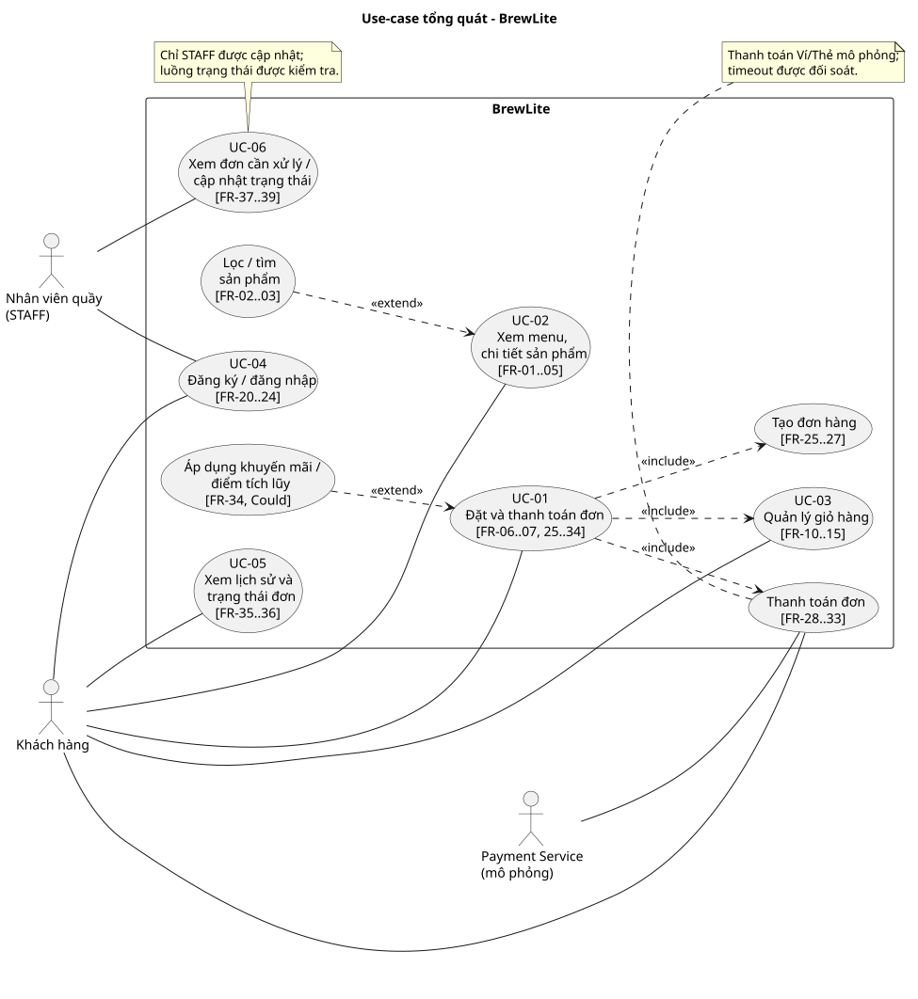

# SRS tổng quát – BrewLite

| Mục | Nội dung |
|---|---|
| Phiên bản | 1.0 |
| Trạng thái | Bộ mã FR/NFR chính thức dùng chung trong repository |
| Phạm vi | MVP đặt đồ uống tại quầy; thanh toán mô phỏng; một cửa hàng |
| Nguồn | [`context-and-scope.md`](./context-and-scope.md), [`deployment-nfr.md`](./deployment-nfr.md), [`architecture.md`](../architecture/architecture.md), [`README.md`](../../README.md) |

## 1. Quy ước mã

- Mã `FR-01`…`FR-39` và `NFR-01`…`NFR-20` là mã chuẩn, duy nhất cho toàn dự án.
- Các dải FR giữ nguyên quy ước phân nhóm: `01–09` menu/sản phẩm; `10–19` giỏ hàng; `20–24` xác thực; `25–34` đặt hàng/thanh toán; `35–39` lịch sử/trạng thái đơn.
- NFR được đánh số lại liên tục từ `NFR-01` đến `NFR-20` để loại bỏ các mã cục bộ trùng hoặc không đồng nhất; chỉ mã NFR chuẩn ở Mục 4 được dùng trong tài liệu thiết kế, ma trận truy vết và kiểm thử.
- FR-09 là mã Won't được giữ duy nhất để lưu quyết định loại bỏ quản trị catalog; Won't và nội dung ngoài phạm vi khác không được cấp mã FR/NFR.

## 2. Stakeholder và quy tắc nghiệp vụ

| Actor | Mục tiêu / quyền chính |
|---|---|
| Khách hàng | Xem menu, chọn món, đăng ký/đăng nhập, đặt và thanh toán đơn, xem lịch sử và trạng thái đơn của mình |
| Nhân viên quầy (STAFF) | Xem đơn và cập nhật trạng thái xử lý đơn |
| Payment Service mô phỏng | Actor phụ nhận yêu cầu thanh toán Ví/Thẻ và trả kết quả; adapter được cài trong API |

Hệ thống phục vụ một cửa hàng, khách nhận tại quầy, đơn vị tiền tệ là VND nguyên, khách phải đăng nhập để đặt đơn, giá hợp lệ do server tính, còn giỏ hàng được giữ ở client. Thanh toán là mô phỏng. Promotion/tích điểm là phạm vi mở rộng (Could); gateway thật, giao hàng, quản trị catalog, hoàn tiền, hủy đơn đã thanh toán và push/SMS/email nằm ngoài phạm vi.

## 3. Yêu cầu chức năng

MoSCoW: **Must** bắt buộc, **Should** nên có, **Could** tùy thời gian.

### 3.1 Menu và sản phẩm (`FR-01`–`FR-09`)

| Mã | Yêu cầu và tiêu chí chấp nhận | Ưu tiên |
|---|---|---|
| FR-01 | Hệ thống hiển thị menu phân trang gồm sản phẩm đang bán, tên, ảnh, giá cơ bản, danh mục và tình trạng còn/hết hàng (`GET /products` trả HTTP 200 kèm phân trang; sản phẩm ngừng bán không hiển thị cho khách). | Must |
| FR-02 | Khách hàng có thể lọc menu theo danh mục (chọn danh mục hiển thị đúng các món thuộc danh mục đó; bỏ lọc trả về toàn bộ menu). | Should |
| FR-03 | Khách hàng có thể tìm sản phẩm theo tên, không phân biệt hoa thường và dấu tiếng Việt (tìm kiếm khớp đúng theo tên; không có kết quả hiển thị empty state). | Could |
| FR-04 | Hệ thống hiển thị chi tiết sản phẩm gồm mô tả, ảnh, giá cơ bản, tồn kho và danh mục (`GET /products/:id` trả HTTP 200; sản phẩm không tồn tại trả 404). | Must |
| FR-05 | Hệ thống hiển thị các size và topping khả dụng của sản phẩm cùng giá phụ thu (tùy chọn không khả dụng bị ẩn hoặc khóa chọn). | Must |
| FR-06 | Hệ thống tính giá món ở server theo `(giá cơ bản + phụ thu size + tổng phụ thu topping) × số lượng`; đơn vị VND nguyên và luôn bỏ qua giá do client gửi. | Must |
| FR-07 | Hệ thống kiểm tra tồn kho và không chấp nhận số lượng vượt tồn kho; mặt hàng `stockQuantity = 0` hiển thị rõ “Hết hàng” và không cho đặt. | Must |
| FR-08 | Migration/seed tạo dữ liệu menu mẫu và chạy lặp lại nhiều lần không sinh bản ghi trùng. | Must |
| FR-09 | Quản lý thêm/sửa/xóa sản phẩm qua UI/API quản trị. **Won't trong MVP; giữ mã để truy vết quyết định phạm vi.** | Won't |

### 3.2 Giỏ hàng (`FR-10`–`FR-19`)

| Mã | Yêu cầu và tiêu chí chấp nhận | Ưu tiên |
|---|---|---|
| FR-10 | Khách thêm món cùng các thuộc tính cấu hình được (size, đường/đá nếu áp dụng, topping) và số lượng vào giỏ khi đã chọn đủ thuộc tính bắt buộc; thêm thành công cập nhật ngay số lượng trên biểu tượng giỏ và gộp các dòng hàng có cùng sản phẩm, toàn bộ tùy chọn giống nhau. | Must |
| FR-11 | Khách xem các món trong giỏ gồm ảnh, tên, tùy chọn, đơn giá, số lượng, thành tiền và tổng tạm tính (bằng tổng `(đơn giá + phụ thu topping) × số lượng`); giỏ trống có thông báo riêng. | Must |
| FR-12 | Khách tăng/giảm hoặc nhập số lượng; thay đổi cập nhật tổng tạm tính, chặn số lượng âm/vượt tồn; giảm về 0 yêu cầu xác nhận xóa. | Must |
| FR-13 | Khách xóa một dòng hoặc làm trống giỏ; thao tác xóa có xác nhận và giao diện cập nhật đúng trạng thái rỗng. | Must |
| FR-14 | Khách vãng lai và khách đã đăng nhập đều giữ được giỏ hàng phía client (`LocalStorage`) sau khi đóng/mở trình duyệt, kể cả khi chuyển sang đăng nhập; không đồng bộ sang thiết bị khác. | Should |
| FR-15 | Khách nhập mã khuyến mãi tại giỏ; hệ thống kiểm tra mã hợp lệ (báo rõ nếu không hợp lệ) và hiển thị mức giảm/tổng tạm tính mới. Việc xác thực và tính tiền cuối cùng do server thực hiện theo FR-26 và FR-34. | Could |
| FR-16 | Giao diện mobile-first, responsive từ viewport 320 px trở lên, thích ứng tablet và desktop; vùng chạm chính tối thiểu 48×48 CSS px. | Must |
| FR-17 | Ứng dụng hỗ trợ cài đặt PWA lên màn hình chính bằng manifest/service worker và cache ngoại tuyến cơ bản cho trang/tài nguyên tĩnh công khai. | Should |
| FR-18 | Khi tải dữ liệu, không hiện màn hình trắng; UI có loading (skeleton/spinner), empty và error state thân thiện, kèm hướng dẫn và hành động tiếp theo như thử lại. | Must |
| FR-19 | Cung cấp bottom navigation trên mobile, header navigation trên desktop; chuyển trang phía client không làm mất trạng thái cần giữ của ứng dụng/giỏ hàng. | Must |

Giỏ hàng chỉ lưu phía client (`LocalStorage`), không có cart API/database và không đồng bộ nhiều thiết bị.

### 3.3 Xác thực và phân quyền (`FR-20`–`FR-24`)

| Mã | Yêu cầu và tiêu chí chấp nhận | Ưu tiên |
|---|---|---|
| FR-20 | Người dùng có thể đăng ký tài khoản khách hàng bằng thông tin hợp lệ (tạo tài khoản `CUSTOMER`, mật khẩu băm `bcrypt`, không lưu/log mật khẩu rõ; email trùng hoặc dữ liệu sai bị từ chối với HTTP 409/400). | Must |
| FR-21 | Người dùng có thể đăng nhập và nhận JWT hợp lệ chứa `sub` và `role` (sai thông tin đăng nhập trả HTTP 401). | Must |
| FR-22 | Hệ thống yêu cầu JWT hợp lệ khi tạo đơn, thanh toán hoặc xem dữ liệu đơn cá nhân (thiếu, sai chữ ký hoặc hết hạn trả HTTP 401). | Must |
| FR-23 | Hệ thống chỉ cho khách hàng truy cập đơn của chính họ; lấy chủ đơn từ `sub` trong JWT (bỏ qua `userId` client gửi) và từ chối truy cập đơn người khác với HTTP 403/404. | Must |
| FR-24 | Hệ thống giới hạn thao tác xem đơn quầy và cập nhật trạng thái đơn cho nhân viên có vai trò `STAFF` (người dùng `CUSTOMER` nhận HTTP 403). | Must |

### 3.4 Đặt hàng và thanh toán (`FR-25`–`FR-34`)

| Mã | Yêu cầu và tiêu chí chấp nhận | Ưu tiên |
|---|---|---|
| FR-25 | Khách đã đăng nhập có thể tạo đơn từ giỏ hàng hợp lệ (`POST /orders` trả HTTP 201 với đơn mới ở trạng thái `PENDING_PAYMENT`, chủ đơn lấy từ JWT). | Must |
| FR-26 | Server tính tổng tiền và lưu snapshot tên, giá, size, topping của từng dòng (`OrderItem`, `OrderItemTopping`) tại thời điểm đặt; bỏ qua giá client gửi và không thay đổi theo cập nhật menu sau đó. | Must |
| FR-27 | Tạo đơn, tạo dòng đơn và trừ tồn kho diễn ra trong cùng transaction; thiếu hàng hoặc lỗi giữa chừng rollback toàn bộ, trả HTTP 409 và giữ tồn kho không âm. | Must |
| FR-28 | Khách có thể thanh toán đơn của mình đang `PENDING_PAYMENT` bằng Ví (`WALLET`) hoặc Thẻ (`CARD`) mô phỏng; số tiền lấy từ đơn trong database. | Must |
| FR-29 | `POST /payments` dùng `Idempotency-Key`: cùng key/cùng payload đã `COMPLETED` trả nguyên response cũ (không tính tiền lần 2); đang `IN_PROGRESS` trả 409; cùng key/khác payload trả 422; mỗi đơn tối đa một payment `SUCCESS`. | Must |
| FR-30 | Khi gateway thành công, đơn chuyển `PAID` (HTTP 200); khi thất bại, đơn chuyển trạng thái cuối `PAYMENT_FAILED`, hoàn kho đúng một lần và trả HTTP 402 (thử lại bằng đơn mới và key mới). | Must |
| FR-31 | Khi gateway timeout, payment giữ `PENDING`, đơn giữ `PENDING_PAYMENT` và trả HTTP 202; hệ thống đối soát theo key qua `getStatus` để chốt `PAID` hoặc `PAYMENT_FAILED` (hoàn kho 1 lần). | Should |
| FR-32 | Job nền hủy (`CANCELLED`) các đơn `PENDING_PAYMENT` quá hạn và hoàn tồn kho đúng một lần theo cập nhật có điều kiện; không hủy đơn có payment `PENDING`/`SUCCESS` trước khi đối soát. | Should |
| FR-33 | Giao diện hiển thị xác nhận hoặc lỗi đặt/thanh toán rõ ràng, trạng thái đang xử lý, giữ giỏ khi thất bại/hết hàng và ngăn gửi lặp do bấm nhiều lần. | Must |
| FR-34 | Khách có thể áp dụng khuyến mãi và điểm tích lũy hợp lệ; server kiểm tra điều kiện và tính lại tổng tiền. | Could |

### 3.5 Lịch sử và trạng thái đơn (`FR-35`–`FR-39`)

| Mã | Yêu cầu và tiêu chí chấp nhận | Ưu tiên |
|---|---|---|
| FR-35 | Khách có thể xem danh sách lịch sử đơn của chính mình (`GET /orders`, mặc định 20 đơn/trang, đơn mới trước; không trả đơn của người khác). | Must |
| FR-36 | Khách có thể xem chi tiết snapshot và trạng thái hiện tại của đơn thuộc quyền sở hữu (`GET /orders/:id`, polling mỗi 5 giây khi trang ở foreground và dừng ở trạng thái cuối/rời trang; trả 401/403/404 phù hợp). | Must |
| FR-37 | Nhân viên (`STAFF`) có thể xem danh sách các đơn cần xử lý tại cửa hàng kèm đủ sản phẩm, size, topping và số lượng. | Must |
| FR-38 | Nhân viên có thể cập nhật trạng thái đơn theo luồng hợp lệ sau thanh toán (`PAID → PREPARING → READY → COMPLETED`) và kết quả phản ánh đúng cho khách. | Must |
| FR-39 | Hệ thống từ chối cập nhật trạng thái không hợp lệ hoặc đơn `PENDING_PAYMENT`/`PAYMENT_FAILED`/`CANCELLED` (400), người dùng không đủ quyền (403) hoặc cập nhật cạnh tranh trên trạng thái cũ (409, UI tải lại thay vì gửi lặp). | Must |

Payment có trạng thái riêng `PENDING`, `SUCCESS`, `FAILED`; `PENDING` không được hiển thị thành công và nhân viên không tự sửa trạng thái thanh toán.

## 4. Yêu cầu phi chức năng

| Mã chuẩn | Nhóm | Yêu cầu và tiêu chí nghiệm thu | Ưu tiên |
|---|---|---|---|
| NFR-01 | Hiệu năng menu | Với tối đa 200 sản phẩm seed và 50 kết nối đồng thời trong 30 giây, p95 `GET /products` ≤300 ms. | Should |
| NFR-02 | Hiệu năng tạo đơn | Với dữ liệu seed và 50 kết nối đồng thời trong 30 giây, p95 `POST /orders` ≤500 ms; không tính độ trễ giả lập gateway. | Should |
| NFR-03 | Hiệu năng lịch sử/trạng thái | Dùng PostgreSQL thật với dataset 100 khách, 1.000 đơn (một khách có 100 đơn, mỗi đơn 1–5 dòng); làm nóng 10 giây, đo API đọc (trang 20 đơn) 60 giây/20 kết nối và đo riêng API cập nhật 60 giây/5 kết nối trên các đơn khác nhau. Mỗi API p95 ≤500 ms, không 5xx/timeout; báo cáo ghi rõ cấu hình máy/phần mềm/commit/tải/kết quả và không loại request lỗi. | Should |
| NFR-04 | Hiệu năng giao diện | Thao tác thêm/xóa/đổi số lượng giỏ hàng phía client phản hồi <100 ms; điểm Lighthouse Performance ≥80 và thời gian tải trang đầu <2 giây. | Must |
| NFR-05 | Độ trễ hiển thị trạng thái | Đo từ lúc cập nhật trạng thái server commit đến lúc UI hiện nhãn mới (trang ở foreground, mạng bình thường, API ≤500 ms); phân bố 10 lần chuyển hợp lệ trong chu kỳ polling và cả 10 lần ≤7 giây. | Should |
| NFR-06 | Toàn vẹn và đồng thời | Giá là VND nguyên, ràng buộc `CHECK` tồn kho không âm; tạo đơn/trừ kho all-or-nothing (rollback khi lỗi); không oversell hoặc tính tiền hai lần; mỗi đơn tối đa một payment `SUCCESS`; cập nhật `LocalStorage` nhiều tab không âm thầm làm mất thay đổi. | Must |
| NFR-07 | Bảo mật và logging | Mật khẩu được băm; API kiểm tra JWT, chủ sở hữu và vai trò; đơn gắn với chủ lấy từ JWT; chỉ tin giá server; không ghi log mật khẩu, JWT, secret hoặc dữ liệu thanh toán nhạy cảm. | Must |
| NFR-08 | Phục hồi giao dịch | Timeout/lỗi gateway có thể đối soát, không làm mất/trùng giao dịch; hoàn kho/hủy đơn tối đa một lần. | Must |
| NFR-09 | Trạng thái/phản hồi UI | Khi API chậm (ví dụ trì hoãn 2 giây) UI phân biệt rõ loading/empty/error, không hiện màn hình trắng; nút retry chỉ đọc lại dữ liệu (không tạo đơn/thanh toán/chuyển trạng thái lặp); lỗi 401 không tiếp tục lộ dữ liệu bảo vệ và không báo thành công giả. | Must |
| NFR-10 | Khả dụng và usability | UI tiếng Việt dễ hiểu, hoàn tất đặt hàng trong <2 phút; hỗ trợ viewport từ 320 px, kiểm tra lịch sử ở 360/390 px không cuộn ngang; vùng chạm chính ≥48×48 CSS px; nhãn trạng thái phân biệt bằng chữ, không chỉ màu. | Must |
| NFR-11 | Tương thích trình duyệt | Giao diện hiển thị đúng, không lỗi layout trên các phiên bản mới nhất của Chrome, Safari, Firefox và Edge. | Must |
| NFR-12 | Hợp đồng API | Hợp đồng request/response cho API sản phẩm, xác thực, đơn, thanh toán và cập nhật trạng thái được công bố bằng Swagger/OpenAPI, khớp hành vi thực tế. | Must |
| NFR-13 | Khả năng kiểm thử | Unit/integration test bao phủ định giá, tồn kho, trạng thái, idempotency, quyền, thanh toán và các trạng thái UI quan trọng; test chạy trong CI. | Must |
| NFR-14 | CI | PR chạy install, lint, unit test và build cho web/API; không merge khi kiểm tra bắt buộc thất bại. | Must |
| NFR-15 | Chạy local/tái tạo dữ liệu | Docker Compose khởi chạy web/API/PostgreSQL; database mới migrate/seed theo README; PostgreSQL dùng persistent volume. | Must |
| NFR-16 | Health check | `GET /health` trả 200 khi API và DB sẵn sàng, 503 khi DB không sẵn sàng; smoke test sau deploy kiểm tra health và menu. | Must |
| NFR-17 | Cấu hình/secrets | Cấu hình lấy từ môi trường; secret thật không xuất hiện trong repository hoặc log CI/CD. | Must |
| NFR-18 | Phát hành/rollback | Deploy có quality gate, image/tag phiên bản, migration trước khi chuyển lưu lượng, smoke test sau deploy; khi lỗi phải dừng và có hướng dẫn rollback. | Must |
| NFR-19 | Production | Web production dùng HTTPS; database có persistent storage, không public trực tiếp; sơ đồ triển khai phản ánh hạ tầng thực tế. | Must |
| NFR-20 | Bàn giao | Có release/tag, release notes và hướng dẫn chạy, test, build, deploy, rollback cho người ngoài nhóm. | Must |

## 5. Use-case tổng quát và truy vết

Nguồn sơ đồ: [`use-case-overview.puml`](../diagrams/use-case-overview.puml); bản SVG: [`use-case-overview.svg`](../diagrams/use-case-overview.svg).

| Use-case | Actor chính | Yêu cầu liên quan |
|---|---|---|
| UC-01 Đặt và thanh toán đơn | Khách hàng, Payment Service mô phỏng | FR-06, FR-07, FR-25…FR-34 |
| UC-02 Xem menu và chi tiết sản phẩm | Khách hàng | FR-01…FR-05 |
| UC-03 Quản lý giỏ hàng | Khách hàng | FR-10…FR-15 |
| UC-04 Đăng ký/đăng nhập | Khách hàng, Nhân viên | FR-20…FR-24 |
| UC-05 Xem lịch sử/theo dõi đơn | Khách hàng | FR-35, FR-36 |
| UC-06 Xử lý đơn tại quầy | Nhân viên | FR-37…FR-39 |

Đặc tả luồng checkout chi tiết tại [`use-case-checkout.md`](./use-case-checkout.md); sơ đồ trình tự tại [`sequence-checkout.puml`](../diagrams/sequence-checkout.puml).

