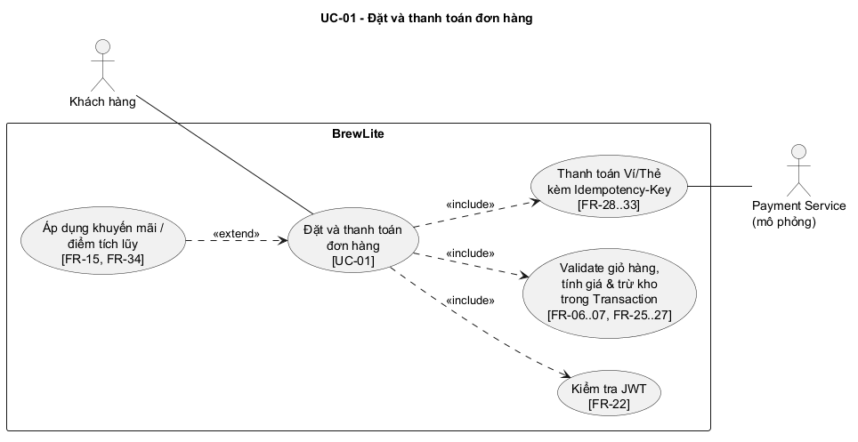

# Đặc tả Use-case: UC-01 – Đặt và thanh toán đơn hàng

Sơ đồ tổng quát: [use-case-overview.svg](../diagrams/use-case-overview.svg) (nguồn: [use-case-overview.puml](../diagrams/use-case-overview.puml)).

## 1. Bảng đặc tả Use Case

| Mục | Nội dung |
| --- | --- |
| **Mã / Tên** | UC-01 – Đặt và thanh toán đơn hàng |
| **Actor** | Chính: Khách hàng. Phụ: Payment Service (mô phỏng) |
| **Trigger** | Khách bấm “Đặt hàng” trong giỏ hàng |
| **Tiền điều kiện** | Đã đăng nhập (có JWT hợp lệ); giỏ hàng có ít nhất 1 món |
| **Hậu điều kiện (thành công)** | Đơn được tạo kèm snapshot giá/tên món, tồn kho đã trừ, thanh toán `SUCCESS`, đơn ở trạng thái `PAID`, khách thấy xác nhận |
| **Hậu điều kiện (thất bại)** | Không trừ tiền; tồn kho không bị trừ sai (rollback khi hết hàng, hoặc hoàn kho đúng 1 lần khi `PAYMENT_FAILED`); khách được thông báo lỗi |
| **Liên kết yêu cầu** | FR-06, FR-07, FR-22, FR-23, FR-25–FR-34; NFR-02, NFR-06–NFR-10 ([SRS tổng quát](./srs.md)) |

## 2. Luồng sự kiện

**Luồng chính:**

1. Khách mở giỏ hàng và bấm “Đặt hàng”.
2. Hệ thống kiểm tra JWT hợp lệ.
3. Hệ thống validate giỏ hàng, tính lại giá phía server và kiểm tra tồn kho.
4. Hệ thống tạo đơn (`PENDING_PAYMENT`), lưu snapshot dòng đơn và trừ tồn kho trong một transaction.
5. Khách chọn phương thức thanh toán (Ví/Thẻ) và xác nhận.
6. Hệ thống kiểm tra `Idempotency-Key` và gọi Payment Service mô phỏng.
7. Payment Service trả kết quả `SUCCESS`.
8. Hệ thống cập nhật thanh toán `SUCCESS` và chuyển trạng thái đơn sang `PAID`.
9. Hệ thống hiển thị màn hình xác nhận đơn.

**Luồng thay thế:**

* **A1:** Khách áp mã khuyến mãi và điểm tích lũy trước bước 4 → hệ thống kiểm tra và tính lại tổng tiền ở server.
* **A2:** Khách đổi phương thức thanh toán trước khi xác nhận ở bước 5.

**Luồng ngoại lệ:**

* **E1:** Chưa đăng nhập hoặc token hết hạn (bước 2) → trả `401`, chuyển sang trang đăng nhập và giữ nguyên giỏ hàng.
* **E2:** Hết hàng (bước 3–4) → rollback transaction, trả `409` báo món hết hàng, không tạo đơn và giữ giỏ hàng để khách chỉnh sửa.
* **E3:** Thanh toán thất bại (bước 7) → chuyển đơn sang `PAYMENT_FAILED`, hoàn lại tồn kho đúng một lần và thông báo lỗi (`402`). Giỏ hàng được giữ nguyên để khách tạo đơn mới kèm `Idempotency-Key` mới nếu muốn thử lại; không thanh toán lại trên đơn đã `PAYMENT_FAILED`.
* **E4:** Khách gửi lại yêu cầu thanh toán (bấm 2 lần/mạng chập chờn ở bước 6) → hệ thống đối chiếu `Idempotency-Key`, trả lại kết quả đã lưu mà không trừ tiền lần hai (hoặc trả `409` nếu đang xử lý, `422` nếu khác nội dung).
* **E5:** Payment Service timeout (bước 7) → payment giữ `PENDING`, đơn giữ `PENDING_PAYMENT` (`202`); hệ thống đối soát trạng thái giao dịch theo `Idempotency-Key` để chốt `PAID` hoặc `PAYMENT_FAILED` (hoàn kho 1 lần).
